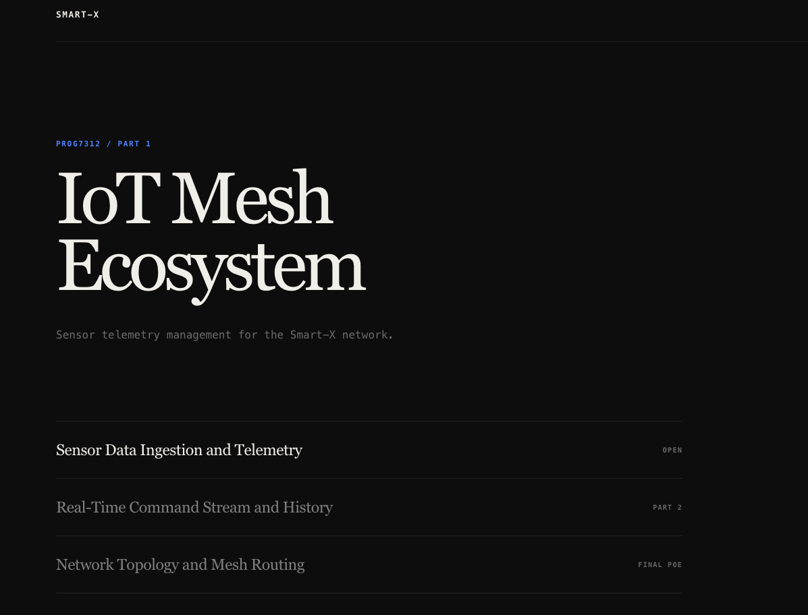
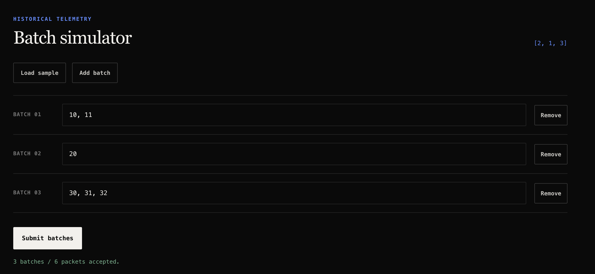
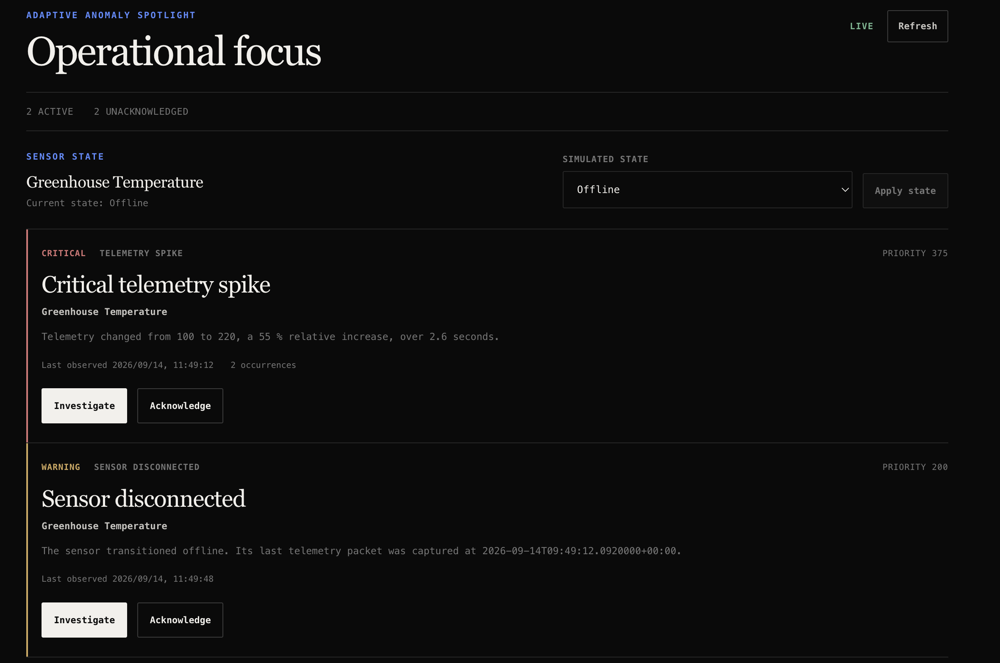
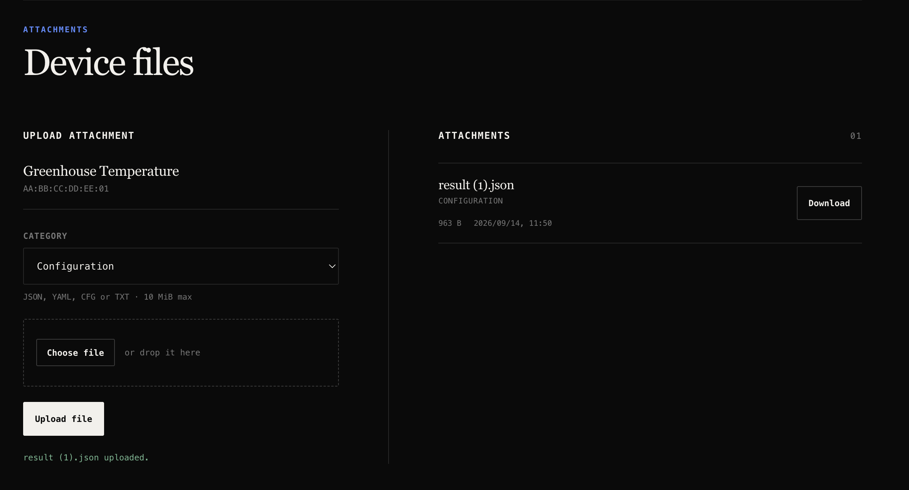
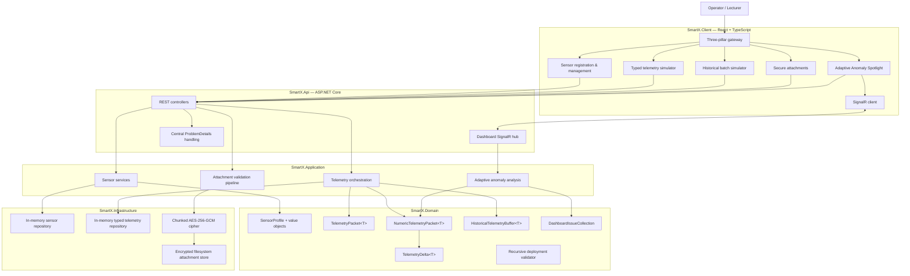
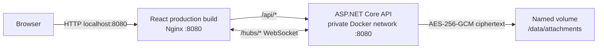

# Smart-X IoT Mesh Ecosystem

**PROG7312 Portfolio of Evidence — Part 1: Data Ingestion and Validation Gateway**

Smart-X is a simulated Internet of Things (IoT) management ecosystem for registering distributed sensors, ingesting strongly typed telemetry, processing historical telemetry batches, detecting operational anomalies, and securely attaching device configuration, deployment, and log files.

Part 1 is implemented as a **React + TypeScript client** communicating asynchronously with a **.NET 10 ASP.NET Core Web API**.

> **Part 1 status:** feature-complete. Final fresh-clone, release, manual demonstration, backup, and submission checks are performed.

---

## Student and Module Information

| Field | Value |
|---|---|
| Student | James Maherry |
| Student number | ST10437403 |
| Module | Programming 3B |
| Module code | PROG7312 |
| Assessment | Portfolio of Evidence |
| Part | Part 1 — Smart-X Data Ingestion and Validation Gateway |
| Backend | .NET 10 / ASP.NET Core |
| Frontend | React / TypeScript / Vite |
| Delivery | GitHub Actions / Docker Compose |

---

## Part 1 at a Glance

Smart-X Part 1 provides:

- a three-pillar startup interface with only **Sensor Data Ingestion and Telemetry** active;
- sensor registration, retrieval, update, and simulated operational-state changes;
- strongly typed `Float`, `Integer`, and `Boolean` telemetry;
- `TelemetryPacket<T>` generic payload handling without weakening values to `object` or `dynamic`;
- meaningful operator overloading for numeric telemetry deltas;
- real jagged-array historical batch ingestion;
- conversion of raw batches into the custom `HistoricalTelemetryBuffer<T>` collection backed by `List<T>`;
- recursive validation of nested Facility → Zone → Sub-zone → Node deployment trees;
- a dynamic **Adaptive Anomaly Spotlight** that reacts to sensor and telemetry changes;
- SignalR-based dashboard invalidation with authoritative HTTP state retrieval;
- secure multipart attachment upload, listing, download, signature validation, and AES-256-GCM encryption;
- responsive and accessible React interfaces;
- backend unit, application, infrastructure, integration, workflow, and browser end-to-end tests;
- Dockerized API and production React/Nginx deployment;
- GitHub Actions validation for backend, frontend, Playwright, and Docker delivery.

---

# Assessment Evidence

The repository contains a deliberately small evidence set under [`docs/evidence/part1`](docs/evidence/part1/README.md). The purpose is to let a marker verify high-value functionality quickly without reverse-engineering the entire solution.

## Demonstration Video

[**Watch the Smart-X Part 1 demonstration on YouTube**](https://youtu.be/hgDRpwixais)

---

## Gateway and Part 1 navigation



The startup view exposes all three Smart-X architectural pillars:

1. **Sensor Data Ingestion and Telemetry** — active in Part 1.
2. **Real-Time Command Stream and History** — disabled until Part 2.
3. **Network Topology and Mesh Routing** — disabled until the final PoE.

## Historical batch processing



The historical simulator feeds the real jagged-array ingestion path. Uneven and empty batches preserve both batch order and packet sequence when transferred to the custom collection.

## Adaptive Anomaly Spotlight



The selected research strategy is implemented as an operational feature rather than a static visual. The backend detects issues, calculates priority, tracks lifecycle state, and notifies the React client through SignalR.

## Secure attachments



Sensor-linked files are streamed through validation and authenticated encryption before persistence. Downloads are decrypted by the API and streamed to the browser.

For the complete evidence index, including responsive layout, Docker, CI, and encrypted-storage evidence, see [`docs/evidence/part1/README.md`](docs/evidence/part1/README.md).

---

# Architecture



## Docker deployment boundary



Only the React/Nginx service publishes a host port. The API remains available to Nginx on the private Compose network.

---

# Solution Structure

```text
Smart-X/
├── .github/
│   └── workflows/
│       └── ci.yml
├── docs/
│   ├── evidence/
│   │   └── part1/
│   └── research/
├── src/
│   ├── SmartX.Domain/
│   ├── SmartX.Contracts/
│   ├── SmartX.Application/
│   ├── SmartX.Infrastructure/
│   ├── SmartX.Api/
│   └── SmartX.Client/
├── tests/
│   ├── SmartX.Domain.Tests/
│   ├── SmartX.Application.Tests/
│   ├── SmartX.Infrastructure.Tests/
│   └── SmartX.Api.IntegrationTests/
├── .dockerignore
├── .env.example
├── compose.yaml
├── Directory.Build.props
├── global.json
├── SmartX.sln
└── README.md
```

## Project responsibilities

| Project | Responsibility |
|---|---|
| `SmartX.Domain` | Core sensor, telemetry, dashboard, deployment, collection, validation, and operator-overloading rules |
| `SmartX.Contracts` | Transport-safe request and response records |
| `SmartX.Application` | Use-case orchestration, mapping, attachment validation, telemetry processing, dashboard analysis |
| `SmartX.Infrastructure` | In-memory repositories and encrypted filesystem attachment persistence |
| `SmartX.Api` | HTTP controllers, SignalR, CORS, exception handling, health endpoint, dependency registration |
| `SmartX.Client` | React UI, client validation, API integration, SignalR integration, responsive interaction |
| `tests/*` | Domain, application, infrastructure, API integration, workflow, and regression coverage |

---

# PoE Requirement Mapping

This section maps the Part 1 requirements directly to the implementation so the assessment criteria can be verified quickly.

| PoE requirement | Smart-X implementation | Primary source evidence | Automated evidence | Visual evidence |
|---|---|---|---|---|
| Three architectural pillars | React gateway with one active and two disabled routes | `src/SmartX.Client/src/` | Playwright E2E | `01-gateway-navigation.png` |
| API integration | React typed API layer → ASP.NET Core controllers | `src/SmartX.Client/src/api/`, `src/SmartX.Api/Controllers/` | API integration + Playwright | Multiple UI captures |
| Sensor profile | `SensorProfile`, `DeviceIdentifier`, `DeploymentLocation`, enums | `src/SmartX.Domain/Sensors/` | Domain + API integration | `02-sensor-registration.png` |
| Generics | `TelemetryPacket<T>` and typed application pipeline | `src/SmartX.Domain/Telemetry/TelemetryPacket.cs` | `SensorTelemetryServiceTests` | `03-typed-telemetry.png` |
| Operator overloading | `NumericTelemetryPacket<T>.operator -` returns `TelemetryDelta<T>` | `src/SmartX.Domain/Telemetry/NumericTelemetryPacket.cs` | numeric telemetry domain tests | `05-adaptive-anomaly-spotlight.png` |
| Jagged arrays | raw `TelemetryPacket<T>[][]` batch mapping | `src/SmartX.Application/Telemetry/SensorTelemetryService.cs` | uneven/empty batch tests | `04-historical-batch-processing.png` |
| `List<T>` optimisation | raw arrays transferred to pre-sized list storage | `src/SmartX.Domain/Telemetry/HistoricalTelemetryBuffer.cs` | historical buffer tests | `04-historical-batch-processing.png` |
| Custom generic collection | `HistoricalTelemetryBuffer<T> : IReadOnlyList<TelemetryPacket<T>>` | `HistoricalTelemetryBuffer.cs` | domain/application tests | `04-historical-batch-processing.png` |
| Recursion | recursive deployment-tree validator with safe termination | `src/SmartX.Domain/Deployment/DeploymentTreeValidator.cs` | deployment validator tests | source/test evidence |
| Dynamic engagement | Adaptive Anomaly Spotlight | `src/SmartX.Application/Dashboard/`, `src/SmartX.Domain/Dashboard/` | dashboard + E2E tests | `05-adaptive-anomaly-spotlight.png` |
| File upload | streamed multipart attachment controller | `src/SmartX.Api/Controllers/SensorAttachmentController.cs` | attachment integration tests | `06-secure-attachments.png` |
| Full encryption | chunked AES-256-GCM before filesystem persistence | `src/SmartX.Infrastructure/Attachments/ChunkedAesGcmAttachmentCipher.cs` | infrastructure cipher tests | `07-encrypted-storage.png` |
| Responsive UI | responsive CSS and accessible interaction states | `src/SmartX.Client/src/` | Playwright | `08-responsive-layout.png` |
| Production delivery | multi-stage API + React/Nginx images and Compose | Dockerfiles + `compose.yaml` | Docker CI job | `09-docker-deployment.png` |
| CI | backend, frontend, E2E, Docker validation | `.github/workflows/ci.yml` | GitHub Actions | `10-ci-validation.png` |

---

# Advanced Part 1 Data Structures

## 1. `TelemetryPacket<T>` — generics without boxing

**PoE requirement:** process different telemetry types efficiently without type-coercion overhead.

Smart-X represents telemetry with:

```csharp
TelemetryPacket<double>
TelemetryPacket<int>
TelemetryPacket<bool>
```

`Payload` remains type `T` throughout the Domain and Application layers. It is not converted to `object` or `dynamic`.

The application maps sensor configuration to concrete packet types:

```text
Float    -> NumericTelemetryPacket<double>
Integer  -> NumericTelemetryPacket<int>
Boolean  -> TelemetryPacket<bool>
```

This means an Environmental Float sensor cannot accept an integer or Boolean payload by mistake. The configured sensor type remains authoritative.

**Key implementation:**

- `src/SmartX.Domain/Telemetry/TelemetryPacket.cs`
- `src/SmartX.Application/Telemetry/SensorTelemetryService.cs`
- `src/SmartX.Application/Telemetry/TelemetryContractMapper.cs`

**Key tests:**

- `tests/SmartX.Domain.Tests/Telemetry/`
- `tests/SmartX.Application.Tests/Telemetry/SensorTelemetryServiceTests.cs`

---

## 2. `NumericTelemetryPacket<T>` and `TelemetryDelta<T>` — operator overloading

**PoE requirement:** use operator overloading for meaningful telemetry calculations.

Numeric telemetry extends the generic packet design using `INumber<T>` and overloads subtraction.

Conceptually:

```text
previous reading = 22.4
current reading  = 27.1
current - previous
                 = +4.7
```

The result is a strongly typed `TelemetryDelta<T>` containing:

- source device identifier;
- previous value;
- current value;
- signed delta;
- absolute delta magnitude;
- elapsed time;
- increase/decrease/unchanged interpretation.

The operation rejects invalid comparisons such as mismatched devices or invalid chronological ordering.

This is used as a real domain operation for change analysis rather than implementing an arbitrary operator purely to satisfy the rubric.

**Key implementation:**

- `src/SmartX.Domain/Telemetry/NumericTelemetryPacket.cs`
- `src/SmartX.Domain/Telemetry/TelemetryDelta.cs`

---

## 3. Jagged arrays — raw historical telemetry batches

**PoE requirement:** use jagged or multidimensional arrays for sequential historical batches before moving data into an optimised collection.

The API accepts batches with different lengths:

```text
Batch 0 -> [10, 11]
Batch 1 -> [20]
Batch 2 -> [30, 31, 32]
```

The Application layer constructs real jagged arrays:

```csharp
TelemetryPacket<T>[][]
```

This is appropriate because historical batches are ordered but not necessarily equal in size.

Validation rejects:

- a null outer collection;
- null inner batches;
- null packet entries;
- telemetry values that do not match the registered sensor type.

Empty inner batches are valid and their boundary is retained.

**Key implementation:**

- `src/SmartX.Application/Telemetry/SensorTelemetryService.cs`

**Key tests:**

- `tests/SmartX.Application.Tests/Telemetry/SensorTelemetryServiceTests.cs`
- `tests/SmartX.Api.IntegrationTests/Telemetry/TelemetryEndpointTests.cs`

---

## 4. `HistoricalTelemetryBuffer<T>` — custom generic collection and `List<T>`

**PoE requirement:** transfer raw arrays into optimised generic collections and purposefully use a custom collection.

After raw jagged-array validation, Smart-X transfers packets into:

```csharp
HistoricalTelemetryBuffer<T>
```

The collection:

- implements `IReadOnlyList<TelemetryPacket<T>>`;
- uses a pre-sized internal `List<TelemetryPacket<T>>`;
- preserves original packet order;
- preserves batch boundaries through `TelemetryBatchRange`;
- supports efficient sequential iteration;
- supports enumerating an original batch without rebuilding another collection;
- avoids repeated list-capacity expansion by pre-counting valid packets.

`TelemetryBatchRange` stores the original batch index, flattened start index, count, end-exclusive index, and whether the batch was empty.

This is the custom generic collection used purposefully by the real ingestion workflow.

**Key implementation:**

- `src/SmartX.Domain/Telemetry/HistoricalTelemetryBuffer.cs`
- `src/SmartX.Domain/Telemetry/TelemetryBatchRange.cs`

---

## 5. Recursive deployment tree

**PoE requirement:** recursively validate nested deployment configurations with a safe base case.

Smart-X models a hierarchy such as:

```text
Facility
└── Zone
    └── Sub-zone
        └── Node
```

`DeploymentTreeValidator` recursively traverses nested deployment nodes. Validation includes explicit termination and safety rules so recursion cannot continue indefinitely.

Protections include:

- a clear leaf/base case;
- maximum-depth protection;
- cycle detection;
- invalid parent/child relationship detection;
- invalid or duplicate reference protection;
- failed-path reporting.

This makes recursion directly relevant to Smart-X deployment validation.

**Key implementation:**

- `src/SmartX.Domain/Deployment/DeploymentTreeValidator.cs`
- `src/SmartX.Domain/Deployment/DeploymentTreeValidationResult.cs`
- `src/SmartX.Domain/Deployment/DeploymentValidationErrorCode.cs`

**Key tests:**

- `tests/SmartX.Domain.Tests/Deployment/`

---

## 6. `DashboardIssueCollection` — dynamic operational state

The selected engagement strategy needs a live collection of actionable operational issues.

The custom dashboard collection manages issue lifecycle state for conditions such as:

- telemetry spikes;
- sensor disconnects;
- repeated failures;
- missing configuration evidence;
- sensor state changes.

Repeated observations update an existing active condition rather than producing uncontrolled duplicates. Issues can move through:

```text
Active -> Acknowledged -> Resolved
```

Resolved conditions disappear from the default active snapshot but may still be requested for historical inspection.

**Key implementation:**

- `src/SmartX.Domain/Dashboard/DashboardIssueCollection.cs`
- `src/SmartX.Application/Dashboard/DashboardIssueService.cs`
- `src/SmartX.Application/Dashboard/AdaptiveAnomalyAnalysisService.cs`

---

## 7. In-memory repositories and lookup structures

Part 1 deliberately keeps sensors and telemetry process-local while hiding persistence behind interfaces:

```text
ISensorRepository
ITelemetryRepository
```

This allows the PoE to focus on the required data structures and application behaviour without coupling controllers to a database.

The sensor repository maintains fast identifier-based duplicate detection, while the telemetry repository preserves typed packet storage and recent-history retrieval.

These repositories can later be replaced by durable infrastructure without rewriting the Domain or API controllers.

---

# Adaptive Anomaly Spotlight

The Part 1 research task selected the **Adaptive Anomaly Spotlight** as the dashboard engagement strategy.

Instead of presenting an operator with an undifferentiated list of telemetry, Smart-X converts system behaviour into prioritised operational issues.

## Conditions currently surfaced

```text
TelemetrySpike
SensorDisconnected
RepeatedFailure
ConfigurationIssue
SensorStateChange
```

Severity levels:

```text
Information
Warning
Critical
```

Lifecycle states:

```text
Active
Acknowledged
Resolved
```

The backend remains authoritative. SignalR sends lightweight invalidation notifications; the React client then reloads the current dashboard snapshot over HTTP.

Priority considers operational factors including severity, recurrence, recency, lifecycle state, and the underlying condition. Acknowledging an issue records that an operator has seen it, but does not falsely resolve the underlying problem.

This design directly supports the research goal: reduce troubleshooting time by moving the operator toward the most relevant sensor, telemetry, or attachment evidence.

**Primary implementation:**

- `src/SmartX.Domain/Dashboard/`
- `src/SmartX.Application/Dashboard/`
- `src/SmartX.Api/Controllers/DashboardIssuesController.cs`
- `src/SmartX.Api/Dashboard/`
- `src/SmartX.Client/src/features/dashboard/AdaptiveAnomalySpotlight.tsx`

---

# Secure Sensor Attachments

Smart-X supports sensor-linked:

```text
Configuration
DeploymentPhoto
HardwareLog
```

## Supported file types

### Configuration

```text
.json
.yaml
.yml
.cfg
.txt
```

### Deployment photos

```text
.jpg
.jpeg
.png
.webp
```

### Hardware logs

```text
.log
.txt
.json
.csv
```

The maximum application-level attachment size is:

```text
10 MiB
```

## Security pipeline

```text
Multipart HTTP request
        |
        v
MultipartReader
        |
        v
File/category/name/content-type validation
        |
        v
Binary signature inspection where applicable
        |
        v
Prefix replay stream
        |
        v
Size-limited stream
        |
        v
Chunked AES-256-GCM
        |
        v
Generated encrypted payload file
```

### Security controls

The upload pipeline implements:

- registered parent-sensor verification;
- attachment category validation;
- file-name length validation;
- control-character rejection;
- `/` and `\` path-separator rejection;
- extension allowlists;
- media-type allowlists;
- JPEG, PNG, and WebP signature inspection;
- streamed size enforcement rather than trusting only `Content-Length`;
- generated physical storage names;
- storage outside the public web root;
- AES-256-GCM authenticated encryption;
- tamper detection;
- truncation detection;
- cancellation propagation;
- cleanup after failed persistence;
- secure browser download headers.

Client file names are metadata only. A file named:

```text
gateway.log
```

is physically stored under generated identifiers similar to:

```text
68b4a84e00a7421782048f672df94c63.payload
68b4a84e00a7421782048f672df94c63.metadata.json
```

The browser never receives or requires the encryption key. The backend decrypts the requested attachment and streams plaintext directly to the response.

Downloads set:

```text
Cache-Control: no-store
X-Content-Type-Options: nosniff
```

---

# Technology Stack

## Backend

- C#
- .NET 10
- ASP.NET Core Web API
- ASP.NET Core SignalR
- OpenAPI in Development
- xUnit
- `Microsoft.AspNetCore.Mvc.Testing`
- `coverlet.collector`
- AES-256-GCM

## Frontend

- React 19
- TypeScript
- Vite
- React Router
- Microsoft SignalR client
- ESLint
- Prettier
- Playwright

## Delivery

- Git
- GitHub
- GitHub Actions
- Docker
- Docker Compose
- Nginx unprivileged runtime image

---

# Prerequisites

Smart-X is cross-platform. The recommended development environment is VS Code, but the commands below do not require a specific IDE.

## Common requirements

Install:

- **Git**
- **.NET 10 SDK**
- **Node.js 24**
- **npm**
- a modern browser
- **Docker Desktop** if using the containerized deployment

Verify:

```bash
git --version
dotnet --version
node --version
npm --version
docker --version
docker compose version
```

The repository `global.json` controls the expected .NET SDK family.

---

## macOS prerequisites

Recommended:

- macOS on Apple Silicon or Intel
- .NET 10 SDK
- Node.js 24
- Git
- OpenSSL
- Docker Desktop for Mac

Verify OpenSSL:

```bash
openssl version
```

No Windows virtual machine is required for this project.

---

## Windows prerequisites

Recommended:

- Windows 10/11
- PowerShell 7 or Windows PowerShell
- .NET 10 SDK
- Node.js 24
- Git for Windows
- Docker Desktop with Linux containers enabled

A separate OpenSSL installation is not required because PowerShell/.NET cryptography can generate the attachment key.

---

# Fresh Clone Setup

Clone the repository:

```bash
git clone https://github.com/EMWCCN/prog7312-group1-2026-prog7312-poe-part1-st10437403-jamesmaherry.git
cd prog7312-group1-2026-prog7312-poe-part1-st10437403-jamesmaherry
```

Restore backend dependencies:

```bash
dotnet restore SmartX.sln
```

Restore frontend dependencies:

```bash
cd src/SmartX.Client
npm ci
cd ../..
```

At this point choose either:

- [Local development](#local-development), or
- [Docker Compose](#docker-compose).

---

# HTTPS Development Certificate

The local React development client targets the ASP.NET Core HTTPS profile at:

```text
https://localhost:7095
```

Trust the .NET development certificate before starting the local stack.

## macOS

```bash
dotnet dev-certs https --trust
```

macOS may request Keychain approval.

## Windows

```powershell
dotnet dev-certs https --trust
```

Windows may display a trust confirmation dialog.

## If the certificate is broken

First try trusting again:

```bash
dotnet dev-certs https --trust
```

If local ASP.NET development certificates are corrupted, they can be recreated:

```bash
dotnet dev-certs https --clean
dotnet dev-certs https --trust
```

> `--clean` removes local ASP.NET Core development certificates. Use it only when certificate repair is actually required.

---

# Local Development

Local development runs Vite and ASP.NET Core as separate processes.

## 1. Configure attachment encryption

A full Smart-X run requires a Base64-encoded **32-byte** attachment key.

### macOS / Linux

```bash
export Attachments__EncryptionKeyBase64="$(openssl rand -base64 32)"
```

Optional custom storage path:

```bash
export Attachments__StoragePath="$PWD/.local/attachments"
```

### Windows PowerShell

```powershell
$keyBytes = New-Object byte[] 32
[System.Security.Cryptography.RandomNumberGenerator]::Fill($keyBytes)
$env:Attachments__EncryptionKeyBase64 = [Convert]::ToBase64String($keyBytes)
```

Optional custom storage path:

```powershell
$env:Attachments__StoragePath = "$PWD\.local\attachments"
```

Do not commit the generated key.

---

## 2. Start the API

From the repository root:

```bash
dotnet run \
  --project src/SmartX.Api \
  --launch-profile https
```

Development addresses:

```text
HTTPS: https://localhost:7095
HTTP:  http://localhost:5203
```

Health check:

```text
https://localhost:7095/api/health
```

---

## 3. Start React

Open a second terminal:

```bash
cd src/SmartX.Client
npm run dev
```

Default client address:

```text
http://localhost:5173
```

In Development, the client defaults to:

```text
https://localhost:7095
```

for API traffic.

The Development CORS configuration already permits:

```text
http://localhost:5173
```

---

## 4. Open Smart-X

Open:

```text
http://localhost:5173
```

---

# Docker Compose

Docker is the simplest way to run the completed production-style Part 1 stack.

The Docker deployment uses:

- a multi-stage .NET 10 API image;
- a multi-stage Node 24 React build;
- an unprivileged Nginx runtime;
- private API networking;
- same-origin `/api/*` reverse proxying;
- SignalR `/hubs/*` WebSocket proxying;
- health checks;
- non-root runtime users;
- a named encrypted-attachment volume.

## 1. Create `.env`

The real `.env` is ignored by Git.

### macOS

```bash
cat > .env <<EOF
SMARTX_HTTP_PORT=8080
SMARTX_ATTACHMENT_ENCRYPTION_KEY_BASE64=$(openssl rand -base64 32)
EOF
```

### Windows PowerShell

```powershell
$keyBytes = New-Object byte[] 32
[System.Security.Cryptography.RandomNumberGenerator]::Fill($keyBytes)
$key = [Convert]::ToBase64String($keyBytes)

@"
SMARTX_HTTP_PORT=8080
SMARTX_ATTACHMENT_ENCRYPTION_KEY_BASE64=$key
"@ | Set-Content -Encoding ascii .env
```

Never commit `.env`.

Verify Git ignores it:

```bash
git check-ignore -v .env
```

---

## 2. Validate configuration

```bash
docker compose config --quiet
```

`--quiet` is deliberate. A normal rendered Compose configuration can include resolved environment values.

---

## 3. Build and start

```bash
docker compose build
docker compose up -d
```

Check status:

```bash
docker compose ps
```

Both services should become healthy.

Open:

```text
http://localhost:8080
```

or the port configured through `SMARTX_HTTP_PORT`.

---

## 4. Verify the deployment

Frontend health:

```bash
curl -fsS http://localhost:8080/healthz
```

API through Nginx:

```bash
curl -fsS http://localhost:8080/api/health
```

SignalR negotiation:

```bash
curl -fsS \
  -X POST \
  'http://localhost:8080/hubs/dashboard/negotiate?negotiateVersion=1'
```

View recent logs:

```bash
docker compose logs --no-color --tail=100
```

---

## 5. Stop Docker

Preserve the attachment volume:

```bash
docker compose down
```

Delete containers **and** persistent attachment storage:

```bash
docker compose down --volumes
```

> Do not use `--volumes` unless deleting persisted encrypted attachment files is intentional.

---

# Environment Variables

ASP.NET Core uses double underscores (`__`) to represent nested configuration keys.

| Variable | Required | Purpose | Default / notes |
|---|---:|---|---|
| `Attachments__EncryptionKeyBase64` | Yes for full local functionality | Base64 32-byte AES-256-GCM key | Never commit |
| `Attachments__StoragePath` | No | Local encrypted attachment directory | `App_Data/attachments` |
| `Cors__AllowedOrigins__0` | No | Additional browser origin | Development already allows Vite |
| `HttpsRedirection__Enabled` | No | Controls ASP.NET HTTPS redirect | `true`; Docker sets `false` internally |
| `ASPNETCORE_ENVIRONMENT` | No | ASP.NET environment | Development via launch profile |
| `ASPNETCORE_URLS` | No | Kestrel bind address | Docker sets internal `:8080` |
| `VITE_API_BASE_URL` | No | React API origin override | Dev defaults to `https://localhost:7095`; production uses same origin |
| `SMARTX_HTTP_PORT` | Docker | Host port for Nginx | `8080` |
| `SMARTX_ATTACHMENT_ENCRYPTION_KEY_BASE64` | Docker | Compose-level attachment secret | Required by `compose.yaml` |

## Secret handling rules

- never commit `.env`;
- never place a real encryption key in `appsettings*.json`;
- never include keys in screenshots;
- never copy a CI test key into a real deployment;
- use a managed secret store before exposing Smart-X outside a local/demo environment.

---

# API Reference

The examples below use the Docker address:

```bash
BASE_URL="http://localhost:8080"
```

For local development, substitute:

```text
https://localhost:7095
```

## Health

```http
GET /api/health
```

```bash
curl -fsS "$BASE_URL/api/health"
```

---

## Sensors

| Method | Endpoint | Purpose |
|---|---|---|
| `POST` | `/api/sensors` | Register a sensor |
| `GET` | `/api/sensors` | List sensors |
| `GET` | `/api/sensors/{id}` | Get one sensor |
| `PUT` | `/api/sensors/{id}` | Update mutable metadata |
| `PATCH` | `/api/sensors/{id}/status` | Simulate/report operational state |

### Register sensor

```bash
curl -i \
  -X POST \
  "$BASE_URL/api/sensors" \
  -H 'Content-Type: application/json' \
  -d '{
    "name": "Greenhouse Temperature A1",
    "deviceIdentifier": "AA:BB:CC:DD:EE:01",
    "identifierKind": "MacAddress",
    "deploymentLocation": {
      "facility": "Cape Town Hydroponics Facility",
      "zone": "Greenhouse A",
      "nodeId": "Node-01"
    },
    "category": "Environmental",
    "telemetryDataType": "Float"
  }'
```

Supported identifier kinds:

```text
MacAddress
UniqueIdentifier
```

Supported categories:

```text
Environmental
PowerConsumption
Actuator
```

Supported telemetry data types:

```text
Float
Integer
Boolean
```

Equivalent MAC formats are canonicalised. For example:

```text
aa-bb-cc-dd-ee-ff
AABBCCDDEEFF
AA:BB:CC:DD:EE:FF
```

all resolve to:

```text
AA:BB:CC:DD:EE:FF
```

Duplicate physical identifiers return a conflict response.

### Update sensor

Device identity is immutable and is therefore excluded from the update contract.

```bash
curl -i \
  -X PUT \
  "$BASE_URL/api/sensors/$SENSOR_ID" \
  -H 'Content-Type: application/json' \
  -d '{
    "name": "Updated Greenhouse Sensor",
    "deploymentLocation": {
      "facility": "Facility B",
      "zone": "Zone 4",
      "nodeId": "Node 9"
    },
    "category": "Environmental",
    "telemetryDataType": "Float"
  }'
```

### Change sensor state

```bash
curl -i \
  -X PATCH \
  "$BASE_URL/api/sensors/$SENSOR_ID/status" \
  -H 'Content-Type: application/json' \
  -d '{
    "status": "Offline"
  }'
```

---

# Telemetry API

| Method | Endpoint | Purpose |
|---|---|---|
| `POST` | `/api/sensors/{id}/telemetry` | Submit one typed reading |
| `POST` | `/api/sensors/{id}/telemetry/batches` | Submit historical jagged batches |
| `GET` | `/api/sensors/{id}/telemetry?limit=50` | Retrieve recent telemetry |

The recent limit defaults to `50` and may not exceed `100`.

## Float reading

Exactly one payload field must be populated.

```bash
curl -i \
  -X POST \
  "$BASE_URL/api/sensors/$SENSOR_ID/telemetry" \
  -H 'Content-Type: application/json' \
  -d '{
    "capturedAtUtc": "2026-09-14T08:00:00Z",
    "floatValue": 24.75,
    "integerValue": null,
    "booleanValue": null
  }'
```

## Integer reading

```json
{
  "capturedAtUtc": "2026-09-14T08:01:00Z",
  "floatValue": null,
  "integerValue": 4200,
  "booleanValue": null
}
```

## Boolean reading

```json
{
  "capturedAtUtc": "2026-09-14T08:02:00Z",
  "floatValue": null,
  "integerValue": null,
  "booleanValue": true
}
```

## Historical batches

The same request contract is nested into uneven arrays.

```bash
curl -i \
  -X POST \
  "$BASE_URL/api/sensors/$SENSOR_ID/telemetry/batches" \
  -H 'Content-Type: application/json' \
  -d '{
    "batches": [
      [
        {
          "capturedAtUtc": "2026-09-14T08:00:00Z",
          "floatValue": 10.0,
          "integerValue": null,
          "booleanValue": null
        },
        {
          "capturedAtUtc": "2026-09-14T08:01:00Z",
          "floatValue": 11.0,
          "integerValue": null,
          "booleanValue": null
        }
      ],
      [
        {
          "capturedAtUtc": "2026-09-14T08:02:00Z",
          "floatValue": 20.0,
          "integerValue": null,
          "booleanValue": null
        }
      ],
      [
        {
          "capturedAtUtc": "2026-09-14T08:03:00Z",
          "floatValue": 30.0,
          "integerValue": null,
          "booleanValue": null
        },
        {
          "capturedAtUtc": "2026-09-14T08:04:00Z",
          "floatValue": 31.0,
          "integerValue": null,
          "booleanValue": null
        }
      ]
    ]
  }'
```

---

# Attachment API

| Method | Endpoint | Purpose |
|---|---|---|
| `POST` | `/api/sensors/{id}/attachments?category=...` | Stream an upload |
| `GET` | `/api/sensors/{id}/attachments` | List attachment metadata |
| `GET` | `/api/sensors/{id}/attachments/{attachmentId}` | Decrypt and stream download |

### Upload configuration file

```bash
curl -i \
  -X POST \
  "$BASE_URL/api/sensors/$SENSOR_ID/attachments?category=Configuration" \
  -F "file=@./gateway-config.json;type=application/json"
```

### Upload hardware log

```bash
curl -i \
  -X POST \
  "$BASE_URL/api/sensors/$SENSOR_ID/attachments?category=HardwareLog" \
  -F "file=@./gateway.log;type=text/plain"
```

---

# Dashboard API

| Method | Endpoint | Purpose |
|---|---|---|
| `GET` | `/api/dashboard/issues` | Current active/acknowledged prioritized issues |
| `GET` | `/api/dashboard/issues?includeResolved=true` | Include resolved history |
| `POST` | `/api/dashboard/issues/{issueId}/acknowledge` | Acknowledge an issue |
| SignalR | `/hubs/dashboard` | Lightweight dashboard-change invalidation |

Acknowledgement deliberately does not resolve the condition. Resolution is driven by recovery of the underlying sensor, telemetry, or configuration state.

---

# Error Responses

Expected application and domain failures are translated centrally to ASP.NET Core `ProblemDetails`.

Examples include:

- invalid registration data → `400`;
- malformed JSON → `400`;
- unknown sensor → `404`;
- duplicate sensor identifier → `409`;
- invalid dashboard transition → `409`.

The API does not intentionally expose internal exception detail to clients.

---

# Automated Testing

Smart-X contains four .NET test projects:

```text
SmartX.Domain.Tests
SmartX.Application.Tests
SmartX.Infrastructure.Tests
SmartX.Api.IntegrationTests
```

The Part 1 backend contains **more than 200 automated tests** across Domain, Application, Infrastructure, HTTP integration, and complete cross-feature workflows.

Coverage includes:

- sensor validation;
- MAC and custom identifiers;
- duplicate registration;
- state transitions;
- generic telemetry;
- `double`, `int`, and `bool` payload preservation;
- operator overloading;
- invalid type rejection;
- jagged historical batches;
- empty and uneven batch preservation;
- custom collection behaviour;
- recursive deployment validation;
- concurrent/in-memory persistence behaviour;
- dashboard priority and lifecycle logic;
- SignalR-driven frontend behaviour;
- file-name and media validation;
- image signature validation;
- size limits;
- path traversal prevention;
- AES encryption/decryption;
- ciphertext tamper detection;
- ciphertext truncation detection;
- upload/download workflows;
- cross-sensor resource isolation;
- `ProblemDetails`;
- malformed JSON.

---

## Backend quality gate

From the repository root:

```bash
dotnet restore SmartX.sln \
  -p:NuGetAudit=true \
  -p:NuGetAuditMode=all \
  -warnaserror:"NU1901;NU1902;NU1903;NU1904"

dotnet format SmartX.sln \
  --verify-no-changes \
  --no-restore

dotnet build SmartX.sln \
  --configuration Release \
  --no-restore

dotnet test SmartX.sln \
  --configuration Release \
  --no-build

git diff --check
```

Run tests without the Release gate:

```bash
dotnet test SmartX.sln
```

---

## Frontend quality gate

```bash
cd src/SmartX.Client

npm ci
npm audit --audit-level=high
npm run lint
npm run format:check
npm run build
```

---

## Playwright end-to-end regression

Install Chromium once if necessary:

```bash
cd src/SmartX.Client
npx playwright install chromium
```

Run:

```bash
npm run test:e2e
```

Playwright owns isolated test servers:

```text
API:    http://127.0.0.1:5095
Client: http://localhost:5173
```

The E2E configuration supplies deterministic **test-only** encryption material. It must not be reused as a real deployment key.

---

## Code coverage

```bash
rm -rf TestResults

dotnet test SmartX.sln \
  --configuration Release \
  --collect:"XPlat Code Coverage" \
  --results-directory TestResults
```

On Windows PowerShell, remove the old result directory with:

```powershell
Remove-Item TestResults -Recurse -Force -ErrorAction SilentlyContinue
```

---

# Continuous Integration

`.github/workflows/ci.yml` validates changes entering `dev` and `main`.

The final Part 1 pipeline contains four gates:

```text
Backend
Frontend
Playwright E2E
Docker Deployment
```

## Backend job

- .NET 10 setup
- NuGet restore and vulnerability audit
- .NET formatting
- Release build
- complete .NET test suite

## Frontend job

- Node.js 24
- `npm ci`
- high-severity dependency audit
- ESLint
- Prettier
- production Vite build

## Playwright job

- real ASP.NET Core server
- real Vite frontend
- Chromium browser regression
- frontend-to-backend workflow coverage

## Docker job

- Compose validation;
- production image build;
- non-root runtime verification;
- health-gated startup;
- React/Nginx verification;
- API reverse-proxy verification;
- SignalR negotiation;
- API host-port privacy verification;
- diagnostics on failure;
- guaranteed cleanup.

---

# Persistence Model

## Sensors and telemetry

Part 1 intentionally uses process-local in-memory persistence for registered sensors and telemetry.

Therefore:

```text
API restart
    -> registered sensors cleared
    -> telemetry cleared
```

This is a deliberate Part 1 boundary, not database persistence.

Repository interfaces allow future parts to replace the current infrastructure without changing controllers or Domain rules.

## Attachments — local mode

By default encrypted attachments are written under the API's configured storage path:

```text
App_Data/attachments
```

`App_Data` is ignored by Git.

## Attachments — Docker mode

Docker mounts:

```text
/data/attachments
```

to a named volume.

Therefore:

```text
docker compose down
    -> encrypted files remain

docker compose down --volumes
    -> encrypted files are deleted
```

Because sensor registration itself is currently in-memory, persisted encrypted files should still be treated as Part 1 runtime evidence rather than a complete durable relational model.

---

# Client and Backend Validation

Validation is intentionally performed in both layers.

## React

The client provides immediate feedback for:

- required registration fields;
- valid identifier input;
- telemetry type/value agreement;
- finite numeric values;
- Int32 integer range;
- attachment category/file selection;
- loading, success, and failure states.

## API / Domain

The backend remains authoritative and repeats all important rules, including:

- physical identifier validation;
- duplicate prevention;
- enum/category validation;
- telemetry type matching;
- timestamp validation;
- finite numeric telemetry;
- attachment file, media, and signature rules;
- size limits;
- deployment hierarchy validation.

This prevents a modified or non-browser client from bypassing critical rules.

---

# Research Deliverable

The reviewed Part 1 research report is stored under:

```text
docs/research/
```

The research evaluates developer-centric IoT dashboard engagement strategies and justifies the Adaptive Anomaly Spotlight used in the application.

---

# Troubleshooting

## `NET::ERR_CERT_AUTHORITY_INVALID` or local HTTPS warning

Trust the ASP.NET Core development certificate:

```bash
dotnet dev-certs https --trust
```

If necessary:

```bash
dotnet dev-certs https --clean
dotnet dev-certs https --trust
```

Restart the browser and API.

---

## React says the API cannot be reached

Confirm the API is running:

```bash
curl -k https://localhost:7095/api/health
```

Then confirm React is running at:

```text
http://localhost:5173
```

For local development, `appsettings.Development.json` permits that origin.

---

## CORS errors

Do not solve CORS by enabling arbitrary origins.

For local development use the provided Development configuration. For another trusted browser origin configure it explicitly:

```text
Cors__AllowedOrigins__0
```

---

## Attachment encryption-key error

Generate a real 32-byte Base64 key.

macOS:

```bash
export Attachments__EncryptionKeyBase64="$(openssl rand -base64 32)"
```

Windows PowerShell:

```powershell
$keyBytes = New-Object byte[] 32
[System.Security.Cryptography.RandomNumberGenerator]::Fill($keyBytes)
$env:Attachments__EncryptionKeyBase64 = [Convert]::ToBase64String($keyBytes)
```

Restart the API after setting the variable.

---

## Docker says the encryption key is missing

Create `.env` before starting Compose.

Then validate:

```bash
docker compose config --quiet
```

Do not print a fully resolved Compose configuration in screenshots or logs when it may expose local environment values.

---

## Docker container remains unhealthy

Inspect:

```bash
docker compose ps
docker compose logs --no-color --tail=200
```

Check the public endpoints:

```bash
curl -fsS http://localhost:8080/healthz
curl -fsS http://localhost:8080/api/health
```

---

## Port 8080 is already in use

Change:

```text
SMARTX_HTTP_PORT
```

inside the ignored `.env`, for example:

```dotenv
SMARTX_HTTP_PORT=9090
```

Then restart:

```bash
docker compose down
docker compose up -d
```

Open:

```text
http://localhost:9090
```

---

## Vite port 5173 is already in use

Stop the conflicting process. The application and Playwright configuration expect the normal Smart-X development port.

On macOS/Linux:

```bash
lsof -i :5173
```

On Windows PowerShell:

```powershell
Get-NetTCPConnection -LocalPort 5173 -ErrorAction SilentlyContinue
```

---

## Docker attachment files exist after API restart but sensors are missing

This is expected in Part 1.

The Docker volume persists encrypted files, while sensor and telemetry repositories remain process-local. Register sensors again after an API restart.

---

## `dotnet format --verify-no-changes` fails

Run:

```bash
dotnet format SmartX.sln --no-restore
```

Then inspect:

```bash
git diff --check
git diff
```

Do not commit unrelated formatting changes without reviewing them.

---

## `npm ci` fails

Confirm Node and npm:

```bash
node --version
npm --version
```

Use the committed `package-lock.json` and do not replace `npm ci` with an ad-hoc install in CI.

---

## Playwright browser missing

```bash
cd src/SmartX.Client
npx playwright install chromium
npm run test:e2e
```

On Linux CI, browser dependencies are installed with Playwright's `--with-deps` option.

---

# Security Notes

- Never commit attachment encryption keys.
- Never expose `.env` contents in screenshots.
- Never use client file names as physical storage paths.
- Do not expose encrypted storage through `wwwroot`.
- Treat content type, extension, file name, and client metadata as untrusted.
- Keep production CORS closed unless a trusted origin is explicitly configured.
- Use HTTPS when exposing Smart-X outside the local Docker demonstration boundary.
- Use a managed secret store for any non-local deployment.

---

# Future Extension

Part 1 deliberately establishes the foundation required by later PoE stages.

## Part 2

Planned concepts include:

- `Queue<T>` for FIFO telemetry;
- priority queues for critical alerts;
- `Stack<T>` command history and undo;
- `Dictionary<TKey,TValue>` device lookup;
- sorted dictionaries for ordered history;
- `HashSet<T>` unique active error tracking;
- predictive action and suggestion logic.

## Final PoE

Planned concepts include:

- binary/search/balanced trees for historical range queries;
- graph-based mesh representation;
- BFS/DFS traversal;
- minimum spanning trees;
- power-efficient route calculation;
- complete three-pillar integration.

---

# Git Workflow

Development uses short-lived branches and pull requests into `dev`.

Commit messages use a concise conventional style, for example:

```text
feat: add strongly typed telemetry pipeline
test: cover secure attachment workflow
fix(docker): stabilize container health validation
docs: complete Part 1 project documentation
```

`dev` is the integration branch. Final Part 1 validation is followed by the release PR from `dev` to `main`.
