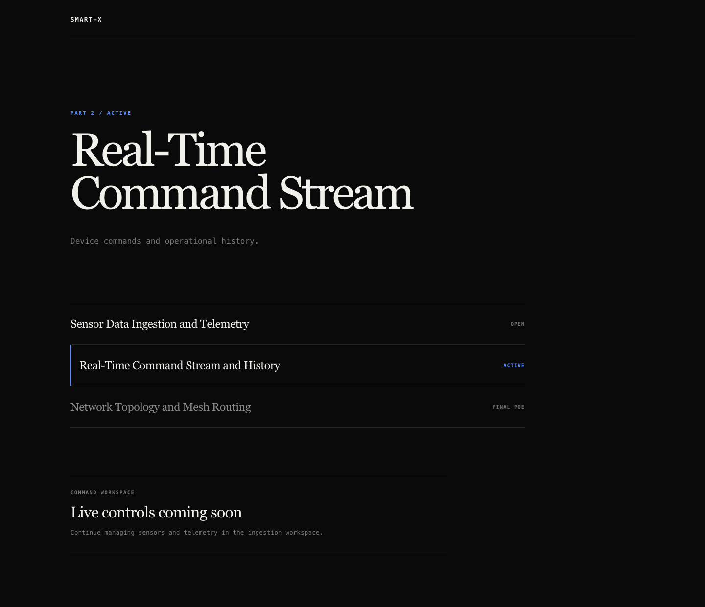
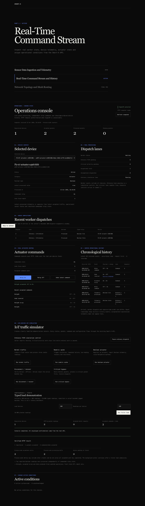
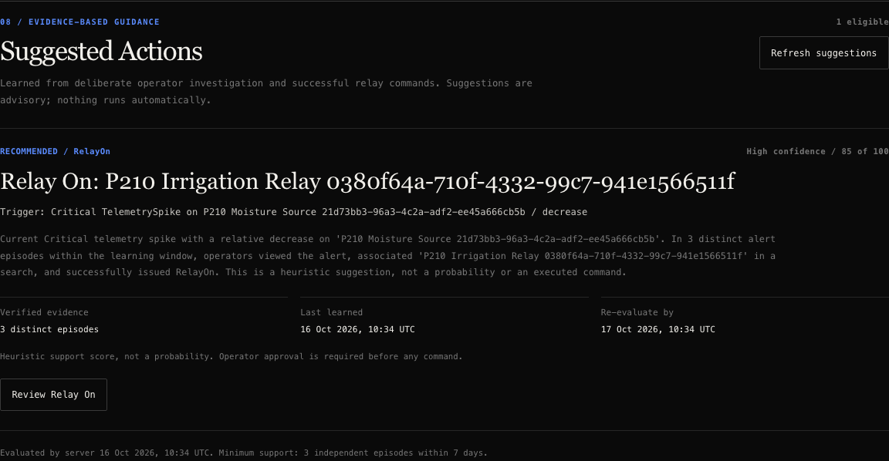

# Smart-X | IoT Telemetry and Real-Time Device Operations

**PROG7312 Portfolio of Evidence — 2026 | Part 1 + Part 2**

Smart-X is a simulated Internet of Things (IoT) control system with a **React/TypeScript frontend**, a **.NET 10 ASP.NET Core API**, and a background telemetry worker. It demonstrates how to ingest device readings, identify active problems, process critical messages ahead of normal traffic, control actuators, and suggest actions based on genuine operator history.

All sensors and actuator operations are **simulated through the real HTTP API**; no physical ESP32 or pump is required. Device/telemetry/command/prediction state is process-local. Encrypted attachment payloads use separate filesystem storage.

**Project:** James Maherry · ST10437403 · PROG7312

**Part 2 demonstration video:** (https://youtu.be/wcMg61C-804)

[Part 2 evidence gallery](docs/evidence/part2/README.md) · [Rubric-to-code guide](docs/part2/ASSESSMENT_RUBRIC_MATRIX.md) · [Part 1 evidence](docs/evidence/part1/README.md)

## What the application does

The `/` gateway has three architectural pillars; the implemented pages are `/ingestion` (Part 1) and `/realtime` (Part 2):

| Pillar | Status | Purpose |
| --- | --- | --- |
| **Sensor Data Ingestion and Telemetry** | Active — Part 1 | Register sensors; ingest Float, Integer, and Boolean readings; submit jagged historical batches; examine anomalies; manage encrypted attachments. |
| **Real-Time Command Stream and History** | Active — Part 2 | Run the IoT simulator; inspect FIFO/critical processing; discover devices; issue relay commands and Undo; inspect history, alerts and Suggested Actions. |
| **Network Topology and Mesh Routing** | Not yet available | Reserved for the final PoE. It is intentionally displayed as unavailable, not presented as an implemented feature. |



### The end-to-end workflow

1. **Register a device.** The Part 1 registry owns the sensor profile, category, operational status, deployment information and canonical physical identifier. Part 2 reads that same registry rather than maintaining a duplicate.
2. **Send telemetry.** Typed single readings and jagged historical batches go through the existing validated API. Successfully accepted readings enter the Part 2 processing buffer; Part 1's ingestion behaviour remains intact.
3. **Process live traffic.** An ordinary `Queue<T>` preserves FIFO order; a `PriorityQueue<TElement,TPriority>` lets critical work bypass waiting ordinary packets. A single background worker processes the accepted packets and exposes real counters.
4. **Observe conditions.** The Adaptive Anomaly Spotlight and the real-time console show server-derived conditions. A `HashSet<T>` tracks each active error membership once; recovery and recurrence follow the actual sensor condition lifecycle.
5. **Find and inspect devices.** Exact physical-identifier lookup uses the canonical `Dictionary<TKey,TValue>` index. Device name/category/status/alert filters use the authoritative server search. Only deliberate operator actions, not passive refreshes or pagination, count as interaction evidence.
6. **Operate and review.** Manual `Relay On` / `Relay Off` changes an eligible actuator's commanded state. A per-actuator `Stack<T>` supports **Undo latest command**; accepted no-ops remain audited without adding misleading Undo entries. The operational timeline uses `SortedDictionary<DateTimeOffset, List<...>>` so events are ordered by capture time and equal timestamps are retained.
7. **Receive an explained suggestion.** Three independent successful response episodes for a matching alert/search/relay pattern within seven days can train an eligible recommendation. When a matching condition recurs, **Suggested Actions** displays the target, command, supporting episodes, explanation, and heuristic confidence **before another search**. The operator must **Review → Confirm**; the existing command API rechecks eligibility, and genuine Undo remains available.





## Architecture

```text
React / TypeScript (Vite during development; Nginx in Docker)
  |-- REST: /api/*       -> ASP.NET Core API (.NET 10)
  |-- SignalR: /hubs/*   -> change notifications; HTTP remains authoritative
                                  |
                    Application services + contracts
                                  |
                Domain models and required collections
                                  |
         Process-local repositories / queues / worker / history
                                  |
              Encrypted attachment filesystem volume
```

The React client refreshes server snapshots after SignalR invalidations; it does not treat a notification as a database of device state. The production Nginx container is the public entry point; the API container is accessible only over the private Compose network. Both run as non-root users.

## Highest-band Part 2 rubric — where to look

These are **implementation and verification references**, not a claim of awarded marks. The allocation follows the official Part 2 rubric (100 marks).

| Assessed criterion | Marks | Behaviour to demonstrate | Source and proof |
| --- | ---: | --- | --- |
| **Main menu and active pillar state** | **30** | Seamless Part 1 ↔ Part 2 routing, retained sensor/filter/draft state, responsive console, final pillar unavailable. | [`PillarNavigation.tsx`](src/SmartX.Client/src/components/PillarNavigation.tsx), [`WorkspaceStateProvider.tsx`](src/SmartX.Client/src/state/WorkspaceStateProvider.tsx), [`navigation E2E`](src/SmartX.Client/e2e/part2-navigation.spec.ts), [navigation screenshot](docs/evidence/part2/01-part2-navigation.png). |
| **Stacks, Queue and PriorityQueue** | **15** | Real FIFO, critical-first bypass despite queued ordinary work, one worker, state-changing relay commands and LIFO Undo. | [`InMemoryTelemetryWorkBuffer.cs`](src/SmartX.Infrastructure/Realtime/InMemoryTelemetryWorkBuffer.cs), [`InMemoryActuatorCommandStore.cs`](src/SmartX.Infrastructure/Commands/InMemoryActuatorCommandStore.cs), [priority evidence](docs/evidence/part2/03-priority-alert-bypass.png), [Undo evidence](docs/evidence/part2/04-command-history-undo.png). |
| **Dictionaries and key-value lookups** | **15** | Average O(1) canonical identifier lookup and time-ordered `SortedDictionary` events with no loss of equal timestamps. | [`InMemorySensorRepository.cs`](src/SmartX.Infrastructure/Sensors/InMemorySensorRepository.cs), [`InMemoryRealtimeHistoryStore.cs`](src/SmartX.Infrastructure/Realtime/InMemoryRealtimeHistoryStore.cs), [search evidence](docs/evidence/part2/05-search-and-filter.png), [history evidence](docs/evidence/part2/06-sorted-history-timeline.png). |
| **Unique collections / sets** | **10** | `HashSet<T>` prevents duplicate unresolved error memberships; recovery removes the active key; recurrence creates fresh evidence. | [`DashboardIssueCollection.cs`](src/SmartX.Domain/Dashboard/DashboardIssueCollection.cs), [active-error evidence](docs/evidence/part2/07-unique-active-errors.png), [`set tests`](tests/SmartX.Domain.Tests/Dashboard/DashboardActiveConditionSetTests.cs). |
| **Predictive action / suggestion engine** | **30** | Real alert-view → associated search → successful relay episodes, proactive explained recommendation, eligibility checks, explicit approval, normal command API and Undo. | [`PredictivePatternLearningService.cs`](src/SmartX.Application/Recommendations/PredictivePatternLearningService.cs), [`PredictiveActionService.cs`](src/SmartX.Application/Recommendations/PredictiveActionService.cs), [`SuggestedActions.tsx`](src/SmartX.Client/src/features/realtime/SuggestedActions.tsx), [genuine journey E2E](src/SmartX.Client/e2e/part2-suggested-actions-journey.spec.ts), [screenshot](docs/evidence/part2/08-suggested-actions.png). |

See the [full rubric evidence matrix](docs/part2/ASSESSMENT_RUBRIC_MATRIX.md) for exact tests, explanations, assessment steps and the distinction between average O(1) lookups and filtered scans.

## Quick demonstrations

The **Real-Time Command Stream and History** pillar includes an **IoT traffic simulator**. These scenarios use the real API and are repeatable on a fresh process-local instance.

| Requirement | How to demonstrate it | Visual evidence |
| --- | --- | --- |
| FIFO and critical priority | Choose **Run critical bypass**. The simulator pauses ordinary dispatch, submits ordinary readings followed by a critical reading, verifies the critical packet runs first, and restores the ordinary lane. | [Priority bypass](docs/evidence/part2/03-priority-alert-bypass.png) |
| Real Stack Undo | Choose **Run boolean actuator**, or select an Online Boolean actuator, press **Relay On**, then **Undo latest command**. Confirm the Off state, reduced Stack depth and retained audit. | [Command / Undo](docs/evidence/part2/04-command-history-undo.png) |
| Dictionary / search | Under **Find devices**, use an exact physical identifier or name/category/status/active-condition filters; inspect or associate an active alert deliberately. | [Search and filter](docs/evidence/part2/05-search-and-filter.png) |
| Sorted history | Select a device and inspect its operational history. The dedicated evidence script and tests also submit backfilled and equal-time events. | [Sorted timeline](docs/evidence/part2/06-sorted-history-timeline.png) |
| Unique conditions | Run the numeric-spike or disconnect/recover simulator scenario; inspect occurrence counts, recovery and a subsequent recurrence. | [Unique active conditions](docs/evidence/part2/07-unique-active-errors.png) |
| Learned prediction | Run the real learn/suggest/execute/Undo journey, or present the captured result and its real-API Playwright verification. No recommendation is generated from mere page loads. | [Suggested Actions](docs/evidence/part2/08-suggested-actions.png) |

## Running Smart-X

### Prerequisites

- .NET 10 SDK, Node.js 24/npm, and Git.
- Docker Desktop / Docker Compose for the production-style stack.
- Python 3 for the optional deployment/load evidence scripts.

### Option A — Docker Compose (recommended for demonstration)

Create a private encryption-key file **only if you have not already configured one**:

```bash
# Run at repository root. Never commit or print .env.
if [ ! -f .env ]; then
  printf 'SMARTX_HTTP_PORT=8080\nSMARTX_ATTACHMENT_ENCRYPTION_KEY_BASE64=%s\n' \
    "$(openssl rand -base64 32)" > .env
fi

docker compose config --quiet
docker compose up -d --build
docker compose ps
```

Open **http://localhost:8080** (or your configured `SMARTX_HTTP_PORT`). Verify the frontend and proxied API:

```bash
curl -fsS http://localhost:8080/healthz
curl -fsS http://localhost:8080/api/health
python3 scripts/verify_part2_docker_boundaries.py --base-url http://localhost:8080
```

Stop without deleting encrypted attachment storage:

```bash
docker compose down
```

**Do not use `docker compose down --volumes`** unless permanent deletion of the local encrypted attachment volume is intended.

### Option B — Local API + Vite

From repository root, trust the local HTTPS developer certificate if required and set a fresh non-committed attachment key:

```bash
dotnet dev-certs https --trust
export Attachments__EncryptionKeyBase64="$(openssl rand -base64 32)"
dotnet run --project src/SmartX.Api --launch-profile https
```

In another terminal:

```bash
cd src/SmartX.Client
npm ci
npm run dev
```

Open **http://localhost:5173**. The default local API profile is **https://localhost:7095**. For an existing encrypted attachment store, retain its original key or use a new isolated storage path instead of silently rotating the key.

## Testing and reproducible evidence

Run backend checks from the repository root:

```bash
dotnet restore SmartX.sln \
  -p:NuGetAudit=true -p:NuGetAuditMode=all -p:NuGetAuditLevel=low
dotnet format SmartX.sln --no-restore --verify-no-changes
dotnet build SmartX.sln --configuration Release --no-restore
dotnet test SmartX.sln --configuration Release --no-build
```

Run frontend and **real API** browser regression:

```bash
cd src/SmartX.Client
npm ci
npm audit --audit-level=high
npm run lint
npm run format:check
npm run build
CI=true npm run test:e2e -- --retries=0
cd ../..
```

Playwright starts isolated .NET and Vite servers for its browser tests. Tests for command execution, reconnects and learned recommendations use actual API operations; the focused presentation tests use clearly identified response fixtures where appropriate.

For the bounded finite-load proof, start Docker in an otherwise quiet instance, then run:

```bash
python3 scripts/verify_part2_finite_load.py \
  --base-url http://localhost:8080 \
  --devices 100 --readings-per-device 100 \
  --timeout-seconds 300 \
  --output docs/evidence/part2/part2-load-summary.json
```

The [actual generated report](docs/evidence/part2/part2-load-summary.json) records submitted, HTTP-accepted, worker-processed and independently confirmed history counts; it is **not** a claimed performance benchmark. The script writes `PASS` only after verifying the worker completed accepted traffic and there are no duplicate active memberships. Do not rerun the full load against a busy or shared instance.

GitHub Actions runs four gates: **Backend, Frontend, Playwright E2E, and Docker Deployment**. The Docker gate also verifies direct `/realtime` navigation, both SignalR hub paths, private API networking, health and non-root runtime users. See [`P2-11_DEPLOYMENT_VERIFICATION.md`](docs/part2/P2-11_DEPLOYMENT_VERIFICATION.md).

## Part 1 functionality retained

Part 2 extends, rather than replaces, the earlier gateway. Part 1 still contains typed `TelemetryPacket<T>` models, numeric operator overloading (`TelemetryDelta<T>`), jagged-array batch conversion into a custom `List<T>`-backed collection, recursive deployment validation, the Adaptive Anomaly Spotlight, and streamed AES-256-GCM sensor attachments with type/signature checks. Part 1 registration and ingestion remain the authoritative source for Part 2.

[Part 1 evidence and screenshots](docs/evidence/part1/README.md) · [Part 1 demonstration video](https://youtu.be/hgDRpwixais)

## Important design boundaries

- **No real IoT hardware:** sensors, commands and load are simulated, but all demonstrations use the implemented API and worker.
- **Process-local operational data:** sensor registrations, telemetry, worker queues, command/Undo state, timelines, active conditions and learned patterns are reset when the API process restarts. The encrypted attachment *files* can survive in the Docker volume; the device registry does not automatically survive with them.
- **No automatic relay execution:** recommendations remain advisory until an operator approves them; the server checks current device eligibility again.
- **No ML probability claim:** prediction scores/confidence are deterministic heuristic rankings grounded in recent independent operator responses.
- **Part 3 not implemented:** network topology and mesh routing remain deliberately unavailable.
- **Secrets:** never commit `.env`, attachment keys, connection secrets, or unredacted operational logs. Do not treat screenshots alone as proof of collection complexity; corresponding implementation and tests are linked above.

## Documentation

- [Part 2 evidence index](docs/evidence/part2/README.md) — screenshot links and what each capture supports.
- [Part 2 rubric evidence matrix](docs/part2/ASSESSMENT_RUBRIC_MATRIX.md) — all five categories, classes, tests and exact marking checks.
- [Finite-load evidence report](docs/evidence/part2/part2-load-summary.json) — real observed acceptance, worker and history counts, verified by [`verify_part2_finite_load.py`](scripts/verify_part2_finite_load.py).
- [Deployment verification](docs/part2/P2-11_DEPLOYMENT_VERIFICATION.md) — Nginx, SignalR, worker and container-boundary checks.
- [Predictive workflow](docs/part2/P2-10_SUGGESTED_ACTIONS_WORKFLOW.md) — genuine episode training and operator-confirmed Undo.

**Release status:** Part 2 release preparation and final `dev` → `main` integration are performed in P2-11 Commit 4; this README does not claim a release/tag or Part 2 video has already been published.
