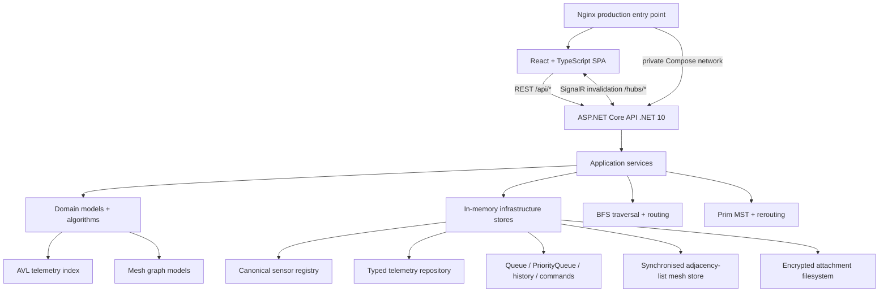

# Smart-X | Integrated IoT Telemetry, Operations and Mesh Routing

**PROG7312 Portfolio of Evidence — 2026 | Parts 1, 2 and 3**

Smart-X is a simulated Internet of Things (IoT) operations platform built with a **React + TypeScript frontend**, a **.NET 10 ASP.NET Core API**, SignalR invalidation streams, background telemetry processing, and a Docker/Nginx deployment boundary. The final application integrates all three coursework pillars in one state-preserving interface:

1. **Sensor Data Ingestion and Telemetry** — registration, typed telemetry, batch history, anomaly analysis and encrypted attachments.
2. **Real-Time Command Stream and History** — FIFO/priority processing, device discovery, commands, Stack-backed Undo, ordered history, active conditions and explained Suggested Actions.
3. **Network Topology and Mesh Routing** — AVL-backed timestamp history, an explicit simulated mesh graph, BFS reachability/fewest-hop routes, Prim minimum spanning tree routing, failure simulation, rerouting, unreachable-state reporting and topology-aware operational insights.

All sensor traffic, commands and mesh links are **simulated through the real HTTP API**. No physical ESP32, radio or pump is required. Operational state is process-local unless otherwise stated; encrypted attachment payloads are stored separately on the filesystem/Docker volume.

**Project:** James Maherry · ST10437403 · PROG7312

**Part 1 demonstration video:** https://youtu.be/hgDRpwixais  
**Part 2 demonstration video:** https://youtu.be/wcMg61C-804  
**Part 3 demonstration video:** **[PLACEHOLDER — add the final Part 3 YouTube URL before submission]**

[Part 3 architecture and data structures](docs/part3/ARCHITECTURE_AND_DATA_STRUCTURES.md) · [Part 3 rubric matrix](docs/part3/ASSESSMENT_RUBRIC_MATRIX.md) · [Part 3 evidence index](docs/evidence/part3/README.md) · [Feedback ledger](docs/part3/FEEDBACK_UPDATES.md)

---

## Final application at a glance

| Pillar                                   | Route        | Final capability                                                                                                                                                                                                     |
| ---------------------------------------- | ------------ | -------------------------------------------------------------------------------------------------------------------------------------------------------------------------------------------------------------------- |
| **Sensor Data Ingestion and Telemetry**  | `/ingestion` | Register and update sensors, ingest Float/Integer/Boolean telemetry, upload historical batches, inspect anomalies and manage encrypted sensor attachments.                                                           |
| **Real-Time Command Stream and History** | `/realtime`  | Observe processing state, search devices, simulate traffic, inspect chronological history, issue relay commands, Undo the latest real state change and review learned Suggested Actions.                             |
| **Network Topology and Mesh Routing**    | `/topology`  | Explore registered devices as graph vertices, configure simulated weighted links, inspect BFS reachability/routes, view Prim MST routing, query AVL history, simulate failures and inspect explained topology risks. |

React Router keeps all three pillars inside one SPA document. `WorkspaceStateProvider` retains the selected sensor and safe workspace drafts across route changes. Server state remains authoritative; SignalR messages are invalidations that trigger HTTP refresh rather than acting as a second state store.

### End-to-end workflow

1. **Register a device** through the Part 1 registry. This remains the single authority for sensor identity, deployment information, category, telemetry type and operational status.
2. **Ingest typed telemetry.** The same accepted `TelemetryPacket<T>` is retained by the original ingestion-order repository and indexed by the Part 3 AVL secondary index.
3. **Process live traffic.** Part 2 routes accepted work through an ordinary `Queue<T>` and critical `PriorityQueue<TElement,TPriority>` before the single background worker records authoritative processing outcomes.
4. **Detect and recover conditions.** Active issue membership uses `HashSet<T>` semantics; occurrence, acknowledgement, recovery and recurrence remain server-owned.
5. **Operate devices.** Eligible Boolean actuators accept Relay On/Off commands. A per-device `Stack<CommandRecord>` supports genuine LIFO Undo while retaining an audit trail.
6. **Learn operator responses.** Deliberate alert/search/command episodes train deterministic, explained Suggested Actions. The UI always requires operator review and the server revalidates the target before execution.
7. **Query historical telemetry by time.** Each sensor/type can use an AVL timestamp index with self-balancing rotations, duplicate timestamp buckets and pruned inclusive range traversal.
8. **Model the mesh.** Registered sensors become graph vertices; explicitly configured links become undirected weighted edges. Costs are **simulated relative routing costs**, not physical RF or energy measurements.
9. **Calculate routes.** BFS reports forwarding eligibility, connected/disconnected components and fewest-link routes. Prim builds a gateway-rooted minimum-total-cost spanning tree over the same eligible component.
10. **Recover from faults.** Link/status mutations increment the graph revision; the application recomputes reachability and MST routing from a fresh immutable snapshot and reports unreachable sensors instead of fabricating connectivity.

---

## Architecture



### Layer responsibilities

- **`SmartX.Domain`** — validated entities/value objects, telemetry generics, AVL tree, graph/routing result models, command and recommendation domain records.
- **`SmartX.Contracts`** — transport-only request/response records; no Domain dependency.
- **`SmartX.Application`** — use-case orchestration, telemetry acceptance, anomaly classification, search, command execution, recommendations, BFS traversal, Prim MST and topology insights.
- **`SmartX.Infrastructure`** — synchronised in-memory repositories, telemetry work buffers/history, command store, pattern store, adjacency-list mesh store and encrypted attachment storage.
- **`SmartX.Api`** — HTTP validation/mapping, exception handling, SignalR hubs, worker hosting and simulation access policy.
- **`SmartX.Client`** — React pages, API adapters, workspace state, accessible topology visualisation and real API Playwright journeys.

For exact source excerpts, invariants and complexity analysis see [`ARCHITECTURE_AND_DATA_STRUCTURES.md`](docs/part3/ARCHITECTURE_AND_DATA_STRUCTURES.md).

---

## How Smart-X maps to the Part 3 rubric

This table is a **traceability guide, not a claim of awarded marks**. The official detailed Part 3 rubric totals 100 marks. The application-side algorithms and integration are complete through P3-11; P3-12 supplies the final README/architecture/evidence documentation. The formal completion report and final recommendation/feedback closure remain P3-13 submission work.

| Part 3 rubric area                                                | Marks | Smart-X implementation and evidence                                                                                                                                                                                                                                                                                                                                                                                                                                                                                                                                                                                                        |
| ----------------------------------------------------------------- | ----: | ------------------------------------------------------------------------------------------------------------------------------------------------------------------------------------------------------------------------------------------------------------------------------------------------------------------------------------------------------------------------------------------------------------------------------------------------------------------------------------------------------------------------------------------------------------------------------------------------------------------------------------------ |
| **Tree Structures and Historical Telemetry Queries**              |    30 | Custom `AvlTelemetryIndex<T>`; LL/RR/LR/RL balancing, duplicate timestamp buckets, inclusive pruned range traversal and keyset pagination. The real API evidence indexes **10,002** and **50,002** Float readings plus typed Integer/Boolean series while retaining the legacy ingestion-order API. See [`AvlTelemetryIndex.cs`](src/SmartX.Domain/Telemetry/AvlTelemetryIndex.cs), [`telemetry-10k.json`](docs/evidence/part3/telemetry-10k.json), [`telemetry-50k.json`](docs/evidence/part3/telemetry-50k.json).                                                                                                                        |
| **Graphs, Network Traversals and Minimum Spanning Trees**         |    30 | Registered sensors are vertices; configured undirected links are weighted edges. BFS uses `Queue` + `HashSet` for fewest-hop reachability. Prim uses `.NET PriorityQueue` + `HashSet` for minimum-total simulated link cost. Failure/recovery evidence includes **256- and 1,000-sensor** meshes and independent Kruskal cross-checks. See [`MeshTraversalService.cs`](src/SmartX.Application/Topology/MeshTraversalService.cs), [`MeshSpanningTreeService.cs`](src/SmartX.Application/Topology/MeshSpanningTreeService.cs), [`mesh-256.json`](docs/evidence/part3/mesh-256.json), [`mesh-1000.json`](docs/evidence/part3/mesh-1000.json). |
| **Implementation Report: README and Structure Code Explanations** |    10 | This README plus [`ARCHITECTURE_AND_DATA_STRUCTURES.md`](docs/part3/ARCHITECTURE_AND_DATA_STRUCTURES.md) provide exact paths, excerpts, diagrams, complexity, algorithm objectives, limits, setup and reproduction instructions.                                                                                                                                                                                                                                                                                                                                                                                                           |
| **Project Completion Report: Challenges and Learnings**           |    10 | The repository already contains issue-level engineering rationale and verification records. The **formal completion report/PDF is intentionally a P3-13 deliverable** and is not falsely marked complete here. The P3-12 matrix identifies the source material to use.                                                                                                                                                                                                                                                                                                                                                                     |
| **Technology Recommendations and Future Scaling**                 |     5 | The final recommendation section belongs to P3-13. P3-12 records the present architecture/limits so recommendations can be justified against real bottlenecks instead of generic cloud claims.                                                                                                                                                                                                                                                                                                                                                                                                                                             |
| **Technology Recommendations: Rationale**                         |     5 | P3-13 will tie each recommendation to measurable security, scalability, operations and performance benefits. This README documents the current boundaries those recommendations must address.                                                                                                                                                                                                                                                                                                                                                                                                                                              |
| **Iterative Feedback Incorporation**                              |     5 | [`FEEDBACK_UPDATES.md`](docs/part3/FEEDBACK_UPDATES.md) records the known Part 2 prediction result without inventing lecturer comments. P3-10 added separate proactive topology-risk insights and preserved the genuinely learned command recommendation workflow. P3-13 closes the ledger with final Git/CI references.                                                                                                                                                                                                                                                                                                                   |
| **Main Menu Integration and Architecture Health**                 |     5 | All three routes are active in one interface, selected-device state survives navigation, topology reads recover without clearing cross-pillar state, and P3-11 final regression passed backend/frontend/browser/Docker gates.                                                                                                                                                                                                                                                                                                                                                                                                              |

The detailed evidence-by-criterion map is in [`docs/part3/ASSESSMENT_RUBRIC_MATRIX.md`](docs/part3/ASSESSMENT_RUBRIC_MATRIX.md).

---

## Why the Part 3 algorithms are different

### AVL range search

The AVL tree answers **timestamp-window** questions over one sensor/type. Self-balancing keeps tree height logarithmic, while range traversal avoids branches that cannot contain timestamps inside the requested interval.

- insertion: **O(log n)** in distinct timestamp keys;
- inclusive range: **O(log n + k)** for `k` returned packets in the balanced-tree model;
- one request is bounded to **10,000** readings;
- equal timestamps are retained in stable per-node buckets rather than overwritten.

### BFS

BFS answers **connectivity and minimum number of links** from the gateway. It intentionally ignores edge weights.

- traversal: **O(V + E)** time;
- traversal state: **O(V + E)** space including adjacency;
- first discovery supplies the fewest-hop predecessor in an unweighted graph.

### Prim MST

Prim answers a different question: **which set of eligible links connects the gateway component with minimum total simulated link cost?** It does not guarantee that every individual sensor receives its cheapest end-to-end path.

The implemented edge-frontier form builds adjacency in **O(V + E)** and uses a min-heap. Each eligible frontier edge is enqueued at most once, giving **O(E log E)** heap work, plus deterministic result ordering. Memory remains **O(V + E)**.

> **Important:** Smart-X link weights are deterministic, positive simulation values used to demonstrate weighted routing. They are not measured radio signal strength, latency, battery draw or physical RF energy.

---

## Running Smart-X

### Prerequisites

The post-P3-11 source-of-truth snapshot was captured with:

- **.NET SDK 10.0.301**
- **Node.js v24.18.0**
- **npm 11.16.0**
- **Git 2.54.0**
- **Docker 29.8.2 / Docker Compose v5.6.0**
- **Python 3.14.6** for optional verification scripts

Equivalent compatible .NET 10 / Node 24 environments should use the repository lock/configuration files rather than ad-hoc dependency upgrades.

### Restore, build and test the backend

From the repository root:

```bash
dotnet restore SmartX.sln \
  -p:NuGetAudit=true \
  -p:NuGetAuditMode=all \
  '-warnaserror:NU1901;NU1902;NU1903;NU1904'

dotnet format SmartX.sln --verify-no-changes --no-restore
dotnet build SmartX.sln -c Release --no-restore
dotnet test SmartX.sln -c Release --no-restore
```

The P3-11 final regression recorded **1,106 backend tests passed, 0 failed** across the four test projects.

### Restore, build and test the client

```bash
cd src/SmartX.Client
npm ci
npm audit --audit-level=high
npm run lint
npm run format:check
npm run build
npm run test:e2e
cd ../..
```

The P3-11 full browser regression recorded **99 passed, 1 intentionally skipped, 0 failed**. The skipped scenario is the opt-in 10,002-reading browser load test; dedicated P3-11 load scripts provide the committed large-dataset evidence.

### Local API + Vite development

Terminal 1, from repository root:

```bash
dotnet dev-certs https --trust
export Attachments__EncryptionKeyBase64="$(openssl rand -base64 32)"
dotnet run --project src/SmartX.Api --launch-profile https
```

The normal client development configuration targets the API at **https://localhost:7095**. The same API profile also exposes `http://localhost:5203` for direct local HTTP scripts.

Terminal 2:

```bash
cd src/SmartX.Client
npm ci
npm run dev
```

Open **http://localhost:5173**.

### Docker Compose deployment

Create a private ignored `.env` file with a fresh attachment key:

```bash
printf 'SMARTX_HTTP_PORT=8080\nSMARTX_ATTACHMENT_ENCRYPTION_KEY_BASE64=%s\nSMARTX_TOPOLOGY_SIMULATION_ENABLED=false\n' \
  "$(openssl rand -base64 32)" > .env
```

The tracked `.env.example` documents the same variables. Never commit `.env`.

For normal demonstration the topology page can be read with simulation disabled. To allow local link create/update/delete operations in the Docker deployment, set this **only on a trusted local environment**:

```text
SMARTX_TOPOLOGY_SIMULATION_ENABLED=true
```

Then:

```bash
docker compose config --quiet
docker compose up -d --build
docker compose ps
```

Open **http://localhost:8080** unless `SMARTX_HTTP_PORT` was changed.

Verify the public Nginx boundary:

```bash
curl -fsS http://localhost:8080/healthz
curl -fsS http://localhost:8080/api/health
curl -fsS http://localhost:8080/api/topology
curl -fsS http://localhost:8080/api/topology/reachability
curl -fsS http://localhost:8080/api/topology/mst
```

Stop the stack without deleting the named attachment volume:

```bash
docker compose down
```

Do **not** use `docker compose down --volumes` unless deletion of the local encrypted attachment volume is intentional.

---

## Core API routes

### Sensor registration and status

| Method  | Route                      | Purpose                                  |
| ------- | -------------------------- | ---------------------------------------- |
| `POST`  | `/api/sensors`             | Register a simulated sensor/actuator.    |
| `GET`   | `/api/sensors`             | List registered profiles.                |
| `GET`   | `/api/sensors/{id}`        | Read one profile.                        |
| `PUT`   | `/api/sensors/{id}`        | Update profile metadata.                 |
| `PATCH` | `/api/sensors/{id}/status` | Change authoritative operational status. |

Example registration:

```bash
curl -sS -X POST http://localhost:5203/api/sensors \
  -H 'Content-Type: application/json' \
  -d '{
    "name": "Greenhouse Temperature",
    "deviceIdentifier": "AA:BB:CC:DD:EE:01",
    "identifierKind": "MacAddress",
    "deploymentLocation": {
      "facility": "Greenhouse A",
      "zone": "North Bed",
      "nodeId": "temp-01"
    },
    "category": "Environmental",
    "telemetryDataType": "Float"
  }'
```

Use the returned `id` in the telemetry examples below.

### Telemetry and AVL timestamp queries

| Method | Route                                       | Purpose                                                             |
| ------ | ------------------------------------------- | ------------------------------------------------------------------- |
| `POST` | `/api/sensors/{sensorId}/telemetry`         | Ingest one strongly typed reading.                                  |
| `POST` | `/api/sensors/{sensorId}/telemetry/batches` | Ingest jagged historical batches.                                   |
| `GET`  | `/api/sensors/{sensorId}/telemetry`         | Preserve the original recent ingestion-order history contract.      |
| `GET`  | `/api/sensors/{sensorId}/telemetry/range`   | Query the AVL timestamp index with bounded inclusive/keyset paging. |

Example Float reading:

```bash
curl -sS -X POST http://localhost:5203/api/sensors/SENSOR_ID/telemetry \
  -H 'Content-Type: application/json' \
  -d '{
    "capturedAtUtc": "2026-11-12T10:00:00Z",
    "floatValue": 24.75,
    "integerValue": null,
    "booleanValue": null
  }'
```

Example bounded range query:

```bash
curl -sS \
  'http://localhost:5203/api/sensors/SENSOR_ID/telemetry/range?fromInclusive=2026-11-12T09:00:00Z&toInclusive=2026-11-12T11:00:00Z&limit=100'
```

For reproducible large-scale AVL evidence use a fresh local API at `127.0.0.1:5095` and the committed verifier rather than manually fabricating results:

```bash
python3 scripts/verify_part3_telemetry_load.py \
  --base-url http://127.0.0.1:5095 \
  --count 10000 --typed-count 96 \
  --samples 25 --warmups 3 \
  --output docs/evidence/part3/telemetry-10k.json
```

Restart the API before the equivalent `--count 50000` run. Full startup and safety instructions are in [`LOAD_VERIFICATION.md`](docs/part3/LOAD_VERIFICATION.md); the committed outputs are [10k](docs/evidence/part3/telemetry-10k.json) and [50k](docs/evidence/part3/telemetry-50k.json).

### Topology, BFS and Prim MST

| Method   | Route                               | Purpose                                                  |
| -------- | ----------------------------------- | -------------------------------------------------------- |
| `GET`    | `/api/topology`                     | Read the current versioned graph projection.             |
| `GET`    | `/api/topology/reachability`        | BFS gateway reachability and fewest-hop counts.          |
| `GET`    | `/api/topology/mst`                 | Gateway-rooted Prim minimum spanning tree projection.    |
| `GET`    | `/api/topology/devices/{id}/route`  | Read a selected registered sensor's BFS/MST route state. |
| `GET`    | `/api/topology/insights`            | Read bounded, explained topology/status risks.           |
| `POST`   | `/api/topology/links`               | Create one explicit undirected simulation link.          |
| `PATCH`  | `/api/topology/links/{linkId}/cost` | Update one positive finite simulated link cost.          |
| `DELETE` | `/api/topology/links/{linkId}`      | Remove an explicitly configured simulation link.         |

Create a simulated link in Development (or trusted Docker simulation mode):

```bash
curl -sS -X POST http://localhost:5203/api/topology/links \
  -H 'Content-Type: application/json' \
  -d '{
    "nodeAKey": "gateway",
    "nodeBKey": "sensor/SENSOR_ID",
    "simulatedEnergyCost": 1.25
  }'
```

The sensor node key is always `sensor/{lowercase-guid}`. The logical gateway key is `gateway`.

### Reproducible self-healing/unreachable demonstration

Run the checked local greenhouse scenario against a fresh Development API:

```bash
python3 scripts/demo_part3_greenhouse.py \
  --base-url http://localhost:5203 \
  --confirm-simulation
```

The script registers six profiles, creates seven explicit simulated links, changes a relay's status, verifies rerouting/unreachable behaviour, and refuses non-loopback targets.

Large graph verification is also reproducible on a fresh local API at `127.0.0.1:5095`:

```bash
python3 scripts/verify_part3_mesh_load.py \
  --base-url http://127.0.0.1:5095 \
  --sensors 256 --samples 11 \
  --output docs/evidence/part3/mesh-256.json
```

Restart the API before the equivalent `--sensors 1000` run. See [`MESH_LOAD_VERIFICATION.md`](docs/part3/MESH_LOAD_VERIFICATION.md) for the complete procedure.

The committed evidence proves 256- and 1,000-sensor scenarios, including disconnected islands, bridge repair, primary gateway-link failure, backup rerouting, complete gateway disconnection, restoration, invalid-write rejection and independent Kruskal MST cost cross-checks.

### Commands, recommendations and Undo

| Method | Route                                            | Purpose                                                                     |
| ------ | ------------------------------------------------ | --------------------------------------------------------------------------- |
| `POST` | `/api/realtime/devices/{deviceId}/commands`      | Issue `RelayOn` or `RelayOff` after server-side eligibility checks.         |
| `POST` | `/api/realtime/devices/{deviceId}/commands/undo` | Undo the expected latest state-changing command using the per-device Stack. |
| `GET`  | `/api/realtime/devices/{deviceId}/commands`      | Read command audit/history.                                                 |
| `GET`  | `/api/realtime/recommendations`                  | Read explained currently eligible Suggested Actions.                        |

The recommended demonstration is through the `/realtime` UI: produce the genuine learn/suggest workflow, choose **Review**, explicitly **Confirm**, then use **Undo latest command**. Existing P2-10 browser evidence proves recommendations remain advisory and use the same normal command endpoint as manual operation.

---

## Marker quick-demo sequence

A marker can verify the highest-value Part 3 behaviour without reading every test:

1. **Start Smart-X** using Docker Compose or the local API + Vite steps above.
2. **Open `/ingestion`**, register an Environmental/Float sensor, ingest several readings and verify normal recent history still works.
3. **Open `/realtime`**, confirm the same selected device is retained, inspect live processing/history, and optionally demonstrate a Boolean relay command plus Undo.
4. **Open `/topology`**, confirm the same registered device appears as a graph vertex and can be selected without a full document reload.
5. **Create explicit simulated links** in Development/trusted simulation mode. Read `/api/topology/reachability` and `/api/topology/mst` and compare the fewest-hop BFS route with the MST route/cost objective.
6. **Run the greenhouse failure script** and observe valid rerouting plus honest unreachable state when connectivity is actually removed.
7. **Inspect AVL history** for the selected sensor using the topology history controls or `/telemetry/range`; duplicate timestamps and bounded paging are covered by the committed API/Domain tests.
8. **Open committed evidence** under [`docs/evidence/part3/`](docs/evidence/part3/README.md): 10k/50k AVL, 256/1000-node mesh and final release-gate JSON.
9. **Review the rubric matrix** at [`docs/part3/ASSESSMENT_RUBRIC_MATRIX.md`](docs/part3/ASSESSMENT_RUBRIC_MATRIX.md), the [`feedback ledger`](docs/part3/FEEDBACK_UPDATES.md), and the [`P3-13 completion-report handoff`](docs/part3/ASSESSMENT_RUBRIC_MATRIX.md#4-completion-report-handoff-to-p3-13).
10. **Run the final local gate** when a full verification is required:

```bash
python3 scripts/verify_part3_final_regression.py --with-docker
```

The committed P3-11 run reached `PASS`, verified the four load artifacts, passed the full backend/frontend/browser gates, built/started healthy Docker containers, checked SPA/API routes and SignalR negotiation, then used normal `docker compose down`.

---

## Verified Part 3 scale evidence

These are **recorded local end-to-end observations**, not universal latency guarantees or isolated microbenchmarks.

### AVL telemetry

| Evidence             | Indexed Float readings | Narrow query (2 rows)              | Broad page (1,000 rows)            | Additional checks                                                                                         |
| -------------------- | ---------------------: | ---------------------------------- | ---------------------------------- | --------------------------------------------------------------------------------------------------------- |
| `telemetry-10k.json` |                 10,002 | p50 **0.648 ms**, p95 **0.766 ms** | p50 **1.725 ms**, p95 **2.039 ms** | descending arrival, duplicate timestamp paging, typed Integer/Boolean, invalid reads, legacy recent order |
| `telemetry-50k.json` |                 50,002 | p50 **0.521 ms**, p95 **0.754 ms** | p50 **1.625 ms**, p95 **1.803 ms** | same checks at larger primary history                                                                     |

The evidence explicitly warns that these values include HTTP/JSON/server/network overhead and do not prove asymptotic complexity by themselves. Structural AVL invariants are verified separately by Domain tests.

### Mesh graph

| Evidence         | Sensors | Initial state                                  | Bridge state                           | Primary gateway link removed              | All gateway links removed | Restored                   |
| ---------------- | ------: | ---------------------------------------------- | -------------------------------------- | ----------------------------------------- | ------------------------- | -------------------------- |
| `mesh-256.json`  |     256 | 231 reachable / 25 disconnected; MST cost 231  | 256 reachable; MST/Kruskal cost 260    | 256 reachable through backup; cost 267    | 256 disconnected          | 256 reachable; cost 260    |
| `mesh-1000.json` |   1,000 | 900 reachable / 100 disconnected; MST cost 900 | 1,000 reachable; MST/Kruskal cost 1004 | 1,000 reachable through backup; cost 1011 | 1,000 disconnected        | 1,000 reachable; cost 1004 |

The production Prim result was independently checked with Kruskal in the verification script. Invalid duplicate/cost/link/route requests were rejected without changing graph version or link count.

---

## Part 1 and Part 2 functionality retained

Part 3 extends the original system rather than replacing it.

### Part 1

- `TelemetryPacket<T>` preserves native Float/Integer/Boolean values.
- Numeric telemetry supports domain-specific delta/operator behaviour.
- Jagged historical batches feed typed collections.
- Recursive deployment-tree validation remains separate from the Part 3 AVL index.
- Adaptive Anomaly Spotlight remains server-derived.
- Attachment uploads are streamed, validated and encrypted with chunked AES-256-GCM storage.

[Part 1 evidence](docs/evidence/part1/README.md)

### Part 2

- ordinary `Queue<T>` plus critical `PriorityQueue<TElement,TPriority>`;
- canonical dictionary device lookup;
- `SortedDictionary<DateTimeOffset, List<HistoryEntry>>` operational timeline;
- `HashSet<T>` active-condition membership;
- per-device `Stack<CommandRecord>` Undo;
- deliberate operator interaction history and deterministic Suggested Actions;
- API-driven simulator, responsive/keyboard client and SignalR-triggered HTTP refresh.

[Part 2 evidence](docs/evidence/part2/README.md) · [Part 2 rubric matrix](docs/part2/ASSESSMENT_RUBRIC_MATRIX.md)

---

## Important boundaries and limits

- **Simulation, not physical radio control.** Link weights are controlled logical costs. Smart-X does not claim measured RF signal, radio discovery or physical power consumption.
- **Process-local operational state.** Sensor registry, telemetry, queue/worker state, commands, graph links, insights and learned patterns reset on API process restart.
- **Attachments are different.** Encrypted attachment files may persist in the Docker named volume; their encryption key must remain stable for previously written files.
- **AVL is a secondary index.** It indexes the same accepted telemetry objects and does not replace the original recent-history semantics.
- **Range pages are live snapshots.** Multi-request keyset pagination is not a transactionally isolated database snapshot.
- **BFS and Prim solve different objectives.** Fewest hops is not equivalent to minimum total tree cost.
- **Unreachable means unreachable.** Smart-X does not manufacture recovery edges. A disconnected or unavailable device is reported explicitly.
- **Recommendations never auto-execute.** Human review and normal command revalidation remain mandatory.
- **No ML probability claim.** Recommendation confidence is a deterministic heuristic based on genuine recent operator-response evidence.
- **Topology simulation mutations are restricted.** Development/Test enable the local simulation workflow; Production requires explicit opt-in and should not expose unauthenticated mutation controls publicly.
- **Evidence timings are observations.** They are useful reproducibility data, not hard production SLOs.

---

## Documentation index

### Part 3

- [`ARCHITECTURE_AND_DATA_STRUCTURES.md`](docs/part3/ARCHITECTURE_AND_DATA_STRUCTURES.md) — AVL, BFS, Prim, graph storage, complexity, diagrams and source excerpts.
- [`ASSESSMENT_RUBRIC_MATRIX.md`](docs/part3/ASSESSMENT_RUBRIC_MATRIX.md) — current 100-mark Part 3 traceability and P3-13 handoff points.
- [`docs/evidence/part3/README.md`](docs/evidence/part3/README.md) — measured evidence index and reproduction commands.
- [`LOAD_VERIFICATION.md`](docs/part3/LOAD_VERIFICATION.md) — 10k/50k real-API AVL verification methodology.
- [`MESH_LOAD_VERIFICATION.md`](docs/part3/MESH_LOAD_VERIFICATION.md) — 256/1000-node graph, BFS, Prim/Kruskal and rerouting verification.
- [`P3-11_FINAL_REGRESSION.md`](docs/part3/P3-11_FINAL_REGRESSION.md) — final cross-stack gate design.
- [`FEEDBACK_UPDATES.md`](docs/part3/FEEDBACK_UPDATES.md) — evidence-constrained response to earlier feedback/results.

### Earlier parts

- [`docs/evidence/part1/README.md`](docs/evidence/part1/README.md)
- [`docs/evidence/part2/README.md`](docs/evidence/part2/README.md)
- [`docs/part2/ASSESSMENT_RUBRIC_MATRIX.md`](docs/part2/ASSESSMENT_RUBRIC_MATRIX.md)
- [`docs/part2/P2-10_SUGGESTED_ACTIONS_WORKFLOW.md`](docs/part2/P2-10_SUGGESTED_ACTIONS_WORKFLOW.md)
- [`docs/part2/P2-11_DEPLOYMENT_VERIFICATION.md`](docs/part2/P2-11_DEPLOYMENT_VERIFICATION.md)

---

## Release/evidence checkpoint

The source-of-truth used to prepare P3-12 was captured from clean `dev` at commit:

```text
47c2b1e6105830ceb8673c2c03bffc34f382b194
Merge pull request #73 from EMWCCN/test/part3-load-regression
```

P3-11 had already completed the load, browser and Docker regression before this documentation pass. P3-12 documents the integrated implementation; **P3-13 remains responsible for the formal completion report/PDF, final technology recommendations/rationale, feedback-ledger closure and submission packaging.**
