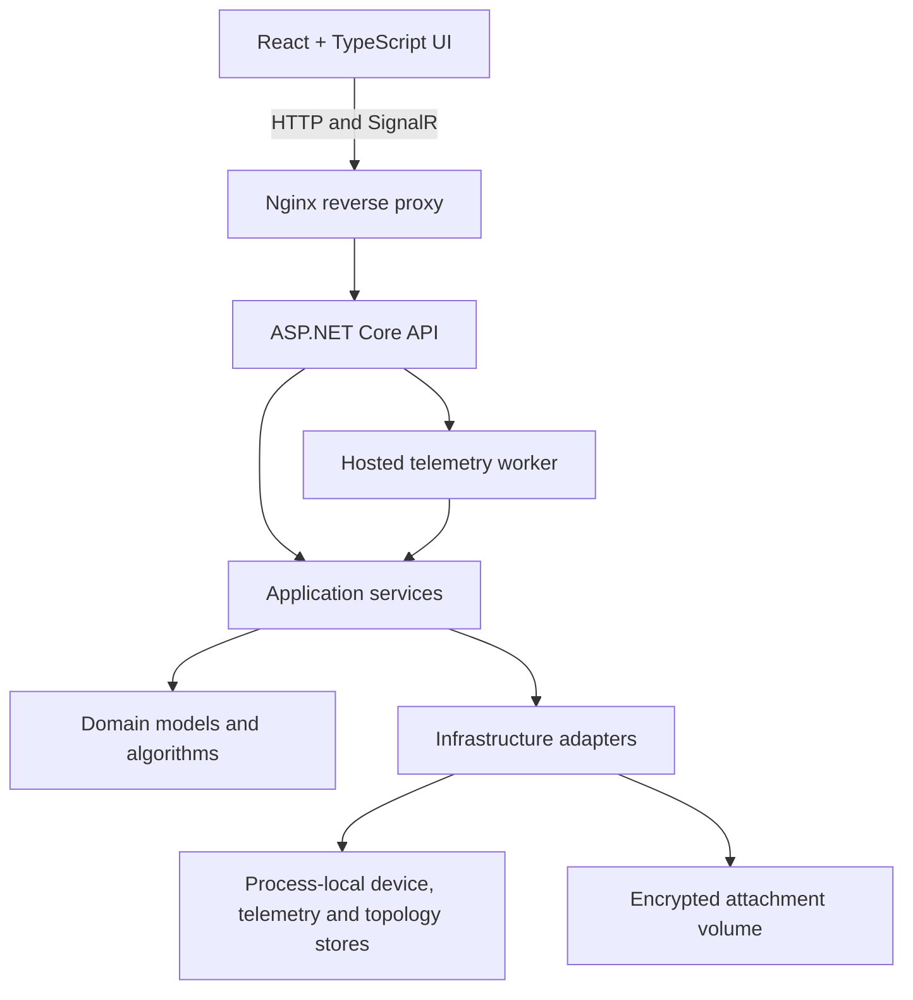

# Smart-X

**A local-first IoT logic lab for telemetry ingestion, real-time operations, and resilient mesh-network algorithms.**

Smart-X brings device registration, typed telemetry, operational events, topology analysis, and human-reviewed remediation into a single React and ASP.NET Core application. It is a software simulation: device traffic, relay commands, and network links use real HTTP endpoints but do **not** operate physical hardware or perform RF measurements.

> **Local-first by design:** Smart-X runs without cloud accounts, third-party APIs, external databases, paid services, or user-supplied API keys. Runtime state is intentionally single-instance and primarily in-memory. It is not a production-ready network controller.

## Capabilities

| Area | What Smart-X does |
| --- | --- |
| Sensor management | Registers and updates devices, validates deployment locations, and accepts Float, Integer, and Boolean telemetry |
| Telemetry and detection | Ingests individual and batch readings, identifies anomalous conditions, and maintains timestamp-indexed history |
| Live operations | Processes ordinary FIFO and critical-priority work, publishes SignalR change notifications, supports discovery and audit-friendly simulated relay commands with Undo |
| Operational intelligence | Maintains active conditions, explains topology risks, and proposes human-reviewed actions from bounded operator-interaction patterns |
| Mesh topology | Models weighted links, reports disconnected components and shortest-hop paths using BFS, computes gateway-rooted minimum spanning trees using Prim, and simulates failure and recovery |
| Attachment handling | Validates uploaded sensor files and encrypts stored payloads using chunked AES-256-GCM |

### Technology stack

- **Backend:** .NET 10, ASP.NET Core Web API, layered Domain/Application/Infrastructure/Contracts projects, background hosted worker, SignalR.
- **Frontend:** React, TypeScript, Vite, React Router.
- **Deployment:** Multi-stage Docker builds, Nginx reverse proxy, Docker Compose, non-root runtime users, private API network.
- **Verification:** xUnit unit/integration tests, Playwright browser tests, ESLint, Prettier, audited dependency restores and container smoke tests in GitHub Actions.

## System architecture



The backend separates transport contracts, domain models, use-case orchestration, persistence adapters and the HTTP boundary. The client treats REST responses as authoritative; SignalR messages trigger refresh rather than introducing a second source of truth.

**Algorithms used for distinct purposes:** AVL indexes answer per-device time-range queries; BFS reports gateway reachability and fewest-hop routes; Prim computes a minimum-total-link-cost spanning tree. A minimum spanning tree is **not** the same as a shortest-path routing algorithm. Link weights model simulated relative cost, not measured latency, energy or radio quality.

## Quick start

### Prerequisites

- **Docker Desktop** (or Docker Engine) with the Compose plugin for the one-command workflow.
- .NET SDK 10, Node.js 24 and Python 3 are **not required** when running through Docker. Install them only for local development, tests or verification scripts.

### One-command Docker startup

From the repository root:

```bash
docker compose up -d --build
```

Open **http://localhost:8080**. No `.env` file, encryption key, API key, hosted database or account is required. Docker builds and starts both the ASP.NET Core API and the React/Nginx client. The API is only accessible through the Nginx proxy and the browser-facing port is bound to **127.0.0.1**, not your LAN or public network.

The API creates a **fresh random 256-bit AES attachment key on its first Docker start**, saves it in the private `smartx-local-keys` named volume and reuses it after restarts. Attachment ciphertext is stored independently in `smartx-attachments`. Neither key nor encrypted attachments are committed to Git. This is a local development convenience; it is **not a production secret-management solution**.

Check the running services:

```bash
docker compose ps
curl -fsS http://localhost:8080/healthz
curl -fsS http://localhost:8080/api/health
```

**What can you explore?** Register simulated sensors, submit typed telemetry and inspect anomalies; interact with the command queue and reversible simulated commands; create weighted mesh links; investigate gateway reachability with BFS, minimum spanning trees with Prim and historical queries using an AVL index. The Compose environment enables topology simulation automatically, and this is safe **only because it is restricted to your own machine**. Do not publish its ports, use a tunnel, or put it behind an internet-facing proxy without implementing authentication and authorization.

**Useful lifecycle commands:**

```bash
docker compose logs -f
docker compose down              # Stop; retain encrypted attachments and key
docker compose up -d --build     # Rebuild/restart with the same key
docker compose down --volumes    # Destructive full reset, including key and attachments
```

Deleting the key volume without the attachment volume will make previously encrypted attachments unreadable. For a full fresh start, delete **both** together using `docker compose down --volumes`.

If port 8080 is taken, use `SMARTX_HTTP_PORT=9090 docker compose up -d --build` and browse to `http://localhost:9090`. An optional [`.env.example`](.env.example) documents this port override. Compose intentionally publishes the frontend on loopback only. The API uses a private Docker network, and ordinary device/telemetry/topology state resets when the API process restarts.

### Guided Simulation Lab

The **Simulation Lab** is the recommended entry point for exploring Smart-X without learning the three technical workbenches first. With Docker running, open **http://localhost:8080/simulation** (or select **Simulation Lab** from the homepage).

The browser controls call existing, validated Smart-X APIs. No separate simulation service, provider key, remote database or Python installation is required for the dashboard. The guided view refreshes one consistent graph revision before displaying its BFS and Prim results.

1. **Choose a scenario:** healthy mesh, primary relay failure, gateway partition or recovery.
2. **Inspect the network:** view the server-provided logical graph and switch between all configured links, a selected sensor's BFS fewest-hop route and the Prim minimum-cost backbone.
3. **Compare outcomes:** see the API-confirmed numbers of reachable, disconnected and unavailable devices before and after the action, plus the Prim total-cost change.
4. **Explore the workbenches:** move into Sensor Ingestion, Real-Time Operations or Topology for additional controls and investigations.

The scenarios use the same six greenhouse fixture sensors and seven weighted logical edges as the backend integration suite. They safely **reuse existing matching demo devices**, reject unrelated sensors and unexpected mesh links, and do not wipe operator telemetry or attachment data. To start from a fresh **in-memory** workspace, use `docker compose restart api`. All relative link weights are simulated costs, not measured energy, RF quality or latency.

**Note:** A run can partially apply if interrupted or if concurrent operators modify the graph. The dashboard reports errors instead of inventing a successful result; refresh the graph and inspect it before retrying. This is a local-only experience and should not be published without authentication and authorization.

### Reproducible mesh experiments

The repository includes an optional **Python 3 standard-library** scenario runner that connects to the same local HTTP API as the web UI. It needs no pip packages, tokens or external services. First start Docker using `docker compose up -d --build`, then run these commands from the repository root:

```bash
python3 scripts/load_mesh_scenario.py healthy
python3 scripts/load_mesh_scenario.py relay-failure
python3 scripts/load_mesh_scenario.py island
python3 scripts/load_mesh_scenario.py recovered
```

Open **http://localhost:8080/topology** between commands to inspect graph links, gateway reachability, the Prim backbone and the consequences of a failed primary relay.

| Scenario | Reachable sensors | Disconnected | Unavailable | Prim total cost |
| --- | ---: | ---: | ---: | ---: |
| `healthy` | 6 | 0 | 0 | 5.75 |
| `relay-failure` | 4 | 1 | 1 | 8.25 |
| `island` | 0 | 5 | 1 | 0 |
| `recovered` | 6 | 0 | 0 | 5.75 |

These outcomes are derived from the existing greenhouse HTTP integration tests. The runner checks the current API responses against the expected graph facts and exits nonzero on a mismatch. All link weights are **simulated relative costs**, not measured physical energy.

**Workspace safety:** The runner refuses non-demo sensors and unexpected mesh links. It updates only its six named fixture devices and seven known edges, does not clear telemetry or operator history, and does not restart containers. Re-running a scenario is safe on the matching fixture; it does not register duplicate devices. To discard the **in-memory** demo workspace, restart the API container: `docker compose restart api`. To discard encrypted attachments and the encryption key as well, use the destructive volume reset documented above.

If you configured a nondefault host port, pass `--url http://localhost:9090` to the script. Remote API targets are intentionally rejected.

### External services and credentials

| Dependency | Required? | Explanation |
| --- | --- | --- |
| Third-party API keys / LLM provider | **No** | Suggestions and topology insights are deterministic local logic, not calls to hosted AI APIs. |
| AWS/Azure/GCP account | **No** | No cloud deployment is needed. |
| Firebase, OAuth provider or hosted identity | **No** | There is currently no login or role-based authorization. |
| Remote database | **No** | Most operational state is held in memory. |
| Manually created attachment encryption key | **No for Docker** | A private key is generated and persisted automatically by the Docker entrypoint. |
| Docker image/package registries | **Yes, for initial build** | Docker builds use public .NET/Node/Nginx base images and restore NuGet/npm dependencies; the app itself makes no third-party API calls. |

### Run the backend and frontend separately

```bash
dotnet dev-certs https --trust
export Attachments__EncryptionKeyBase64="$(openssl rand -base64 32)"
dotnet run --project src/SmartX.Api --launch-profile https
```

In a second terminal:

```bash
cd src/SmartX.Client
npm ci
npm run dev
```

Open **http://localhost:5173**. The default development frontend expects the local API HTTPS profile.

## Quality checks

```bash
dotnet restore SmartX.sln
dotnet format SmartX.sln --verify-no-changes --no-restore
dotnet build SmartX.sln -c Release --no-restore
dotnet test SmartX.sln -c Release --no-restore

cd src/SmartX.Client
npm ci
npm run lint
npm run format:check
npm run build
npm run test:e2e
```

The last recorded verification of the original system ran **1,106 backend tests** successfully and **99 browser tests** successfully (with one optional load test skipped). Those are historical baseline observations, not a claim that the new portfolio branch has already passed CI.

## Security design

- Browser traffic reaches the API through Nginx; the API container is not directly host-published.
- API and frontend containers run as non-root users with no-new-privileges configuration.
- Sensor attachments undergo signature/size validation and encrypted-at-rest storage; local Docker generates and persists its random encryption key on first startup.
- Docker Compose enables topology mutations for local experiments and binds the frontend to loopback, but **there is currently no user authentication or per-user authorization**.
- Suggested actions require explicit operator review and server-side eligibility checks; network insights never execute commands on their own.
- GitHub Actions verifies source quality, dependency audits, test suites, container health and reverse-proxy boundaries.

**Threat model and deployment warning:** These controls do not make Smart-X safe to host publicly as an operational control plane. Authentication, authorization, rate limiting, persistent audit storage, secret management, HTTPS termination and production monitoring need to be implemented and independently tested first.

## Current limitations

1. **Simulation only:** No physical devices, actual RF routes, or measured network energy.
2. **Single-process state:** Device, telemetry, command, topology, history and learning state are primarily held in memory and are lost on restart. Encrypted attachment files have a separate volume lifecycle.
3. **No identity boundary:** There is no implemented login/RBAC or user isolation.
4. **Local-first delivery:** Docker Compose and CI exist, but no validated public-cloud/IaC deployment is included.
5. **No full operations observability:** Distributed traces, managed metrics, centralized logs and alerting remain future work.
6. **Advisory heuristics:** Pattern-derived suggestions are explainable deterministic rules, not probabilities from a trained machine-learning model.

## Engineering direction

The next milestones focus on **testable logic, algorithms and platform engineering** rather than adding paid integrations: reproducible simulation fixtures, structured load testing, deterministic anomaly policies, expanded topology failure scenarios, automated security scanning, and local-only observability. Persistence and authentication can be added later if they serve a clear, tested requirement. Each improvement should have tests, threat and failure considerations, and reproducible evidence.

## Project structure

```text
src/
  SmartX.Api/             HTTP endpoints, background worker, SignalR
  SmartX.Application/     Use cases and orchestration
  SmartX.Contracts/       Request/response contracts
  SmartX.Domain/          Validated models and algorithms
  SmartX.Infrastructure/  Storage and infrastructure adapters
  SmartX.Client/          React + TypeScript UI
tests/                    Backend unit and integration tests
scripts/                  Reproducible local verification utilities
docs/                     Technical architecture, security and verification references
.github/workflows/        Continuous integration
compose.yaml              Local container deployment
docker/local-api-entrypoint.sh  First-run local encryption key bootstrap
```

## Attribution

Developed from the original Smart-X academic team project and subsequently maintained as a separate engineering portfolio repository. The project history is preserved; current documentation and future work describe the independently maintained platform rather than university assessment requirements.

**Maintainer:** James Maherry

## License

No open-source license has been selected yet. Unless and until one is added, normal copyright restrictions apply.
