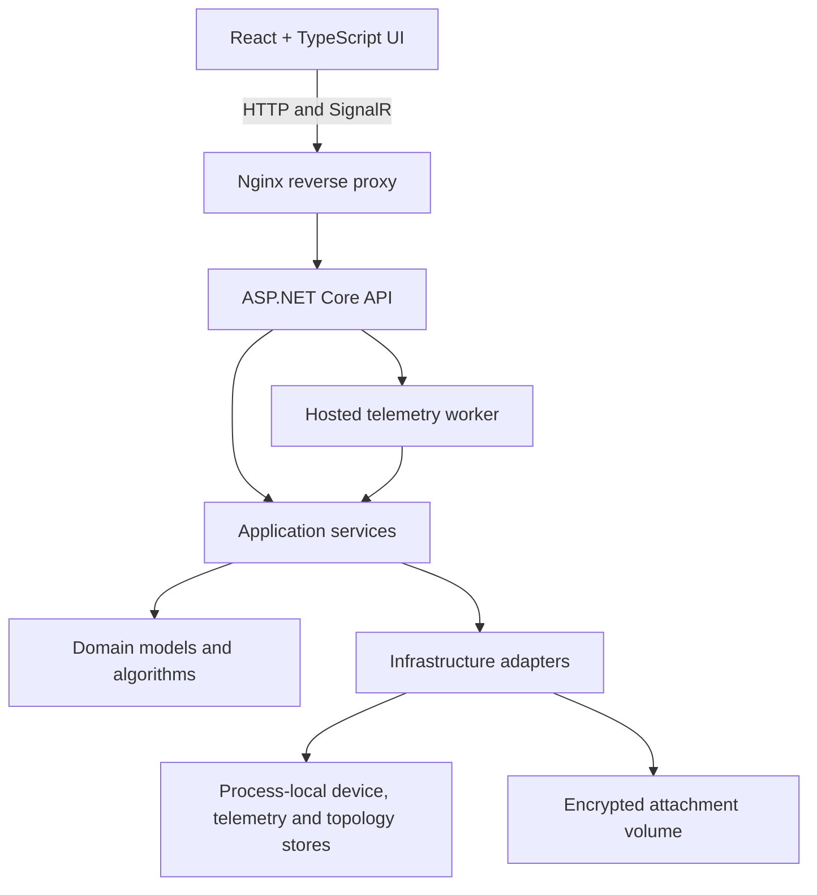

# Smart-X

**A simulated IoT operations platform for telemetry ingestion, real-time device operations, and resilient mesh-network analysis.**

Smart-X brings device registration, typed telemetry, operational events, topology analysis, and human-reviewed remediation into a single React and ASP.NET Core application. It is a software simulation: device traffic, relay commands, and network links use real HTTP endpoints but do **not** operate physical hardware or perform RF measurements.

> **Project status:** actively evolving from a local simulation into a secure, observable, cloud-deployable platform. The current runtime is intentionally single-instance and primarily in-memory. See [current limitations](#current-limitations) before treating it as production software.

## Capabilities

| Area | What Smart-X does |
| --- | --- |
| Sensor management | Registers and updates devices, validates deployment locations, and accepts Float, Integer, and Boolean telemetry |
| Telemetry and detection | Ingests individual and batch readings, identifies anomalous conditions, and maintains timestamp-indexed history |
| Live operations | Processes ordinary FIFO and critical-priority work, publishes SignalR change notifications, supports discovery and audit-friendly simulated relay commands with Undo |
| Operational intelligence | Maintains active conditions, explains topology risks, and proposes human-reviewed actions from bounded operator-interaction patterns |
| Mesh topology | Models weighted links, reports disconnected components and shortest-hop paths using BFS, computes gateway-rooted minimum spanning trees using Prim, and simulates failure and recovery |
| Attachment handling | Validates uploaded sensor files and encrypts stored payloads using chunked AES-256-GCM |

### Technology stack

- **Backend:** .NET 10, ASP.NET Core Web API, layered Domain/Application/Infrastructure/Contracts projects, background hosted worker, SignalR.
- **Frontend:** React, TypeScript, Vite, React Router.
- **Deployment:** Multi-stage Docker builds, Nginx reverse proxy, Docker Compose, non-root runtime users, private API network.
- **Verification:** xUnit unit/integration tests, Playwright browser tests, ESLint, Prettier, audited dependency restores and container smoke tests in GitHub Actions.

## System architecture



The backend separates transport contracts, domain models, use-case orchestration, persistence adapters and the HTTP boundary. The client treats REST responses as authoritative; SignalR messages trigger refresh rather than introducing a second source of truth.

**Algorithms used for distinct purposes:** AVL indexes answer per-device time-range queries; BFS reports gateway reachability and fewest-hop routes; Prim computes a minimum-total-link-cost spanning tree. A minimum spanning tree is **not** the same as a shortest-path routing algorithm. Link weights model simulated relative cost, not measured latency, energy or radio quality.

## Quick start

### Prerequisites

- .NET SDK 10
- Node.js 24 and npm
- Docker with Compose (for containerized deployment)
- Python 3 (optional, for verification tools)

### Run with Docker Compose

From the repository root, create a local, Git-ignored environment file with a fresh encryption key:

```bash
printf 'SMARTX_HTTP_PORT=8080\nSMARTX_ATTACHMENT_ENCRYPTION_KEY_BASE64=%s\nSMARTX_TOPOLOGY_SIMULATION_ENABLED=false\n' \
  "$(openssl rand -base64 32)" > .env

docker compose config --quiet
docker compose up -d --build
```

Open **http://localhost:8080**. Useful health checks:

```bash
curl -fsS http://localhost:8080/healthz
curl -fsS http://localhost:8080/api/health
```

The API is reachable through Nginx on the private Compose network rather than being published to the host directly. To stop services without deleting the encrypted attachment volume, run `docker compose down`.

The topology modification endpoints are disabled in the Docker production configuration by default. For **trusted local demonstrations only**, set `SMARTX_TOPOLOGY_SIMULATION_ENABLED=true` in your ignored `.env` file before starting containers. Do **not** expose an unauthenticated, simulation-enabled instance to the public internet.

### Run the backend and frontend separately

```bash
dotnet dev-certs https --trust
export Attachments__EncryptionKeyBase64="$(openssl rand -base64 32)"
dotnet run --project src/SmartX.Api --launch-profile https
```

In a second terminal:

```bash
cd src/SmartX.Client
npm ci
npm run dev
```

Open **http://localhost:5173**. The default development frontend expects the local API HTTPS profile.

## Quality checks

```bash
dotnet restore SmartX.sln
dotnet format SmartX.sln --verify-no-changes --no-restore
dotnet build SmartX.sln -c Release --no-restore
dotnet test SmartX.sln -c Release --no-restore

cd src/SmartX.Client
npm ci
npm run lint
npm run format:check
npm run build
npm run test:e2e
```

The last recorded verification of the original system ran **1,106 backend tests** successfully and **99 browser tests** successfully (with one optional load test skipped). Those are historical baseline observations, not a claim that the new portfolio branch has already passed CI.

## Security design

- Browser traffic reaches the API through Nginx; the API container is not directly host-published.
- API and frontend containers run as non-root users with no-new-privileges configuration.
- Sensor attachments undergo signature/size validation and encrypted-at-rest storage; the encryption key is supplied at runtime.
- Production topology mutations are opt-in, but **there is currently no user authentication or per-user authorization**.
- Suggested actions require explicit operator review and server-side eligibility checks; network insights never execute commands on their own.
- GitHub Actions verifies source quality, dependency audits, test suites, container health and reverse-proxy boundaries.

**Threat model and deployment warning:** These controls do not make Smart-X safe to host publicly as an operational control plane. Authentication, authorization, rate limiting, persistent audit storage, secret management, HTTPS termination and production monitoring need to be implemented and independently tested first.

## Current limitations

1. **Simulation only:** No physical devices, actual RF routes, or measured network energy.
2. **Single-process state:** Device, telemetry, command, topology, history and learning state are primarily held in memory and are lost on restart. Encrypted attachment files have a separate volume lifecycle.
3. **No identity boundary:** There is no implemented login/RBAC or user isolation.
4. **Local-first delivery:** Docker Compose and CI exist, but no validated public-cloud/IaC deployment is included.
5. **No full operations observability:** Distributed traces, managed metrics, centralized logs and alerting remain future work.
6. **Advisory heuristics:** Pattern-derived suggestions are explainable deterministic rules, not probabilities from a trained machine-learning model.

## Engineering direction

The next milestones focus on **portfolio-grade cloud and security engineering** rather than expanding the simulator for its own sake: durable PostgreSQL-backed state, authentication and authorization, automated security scanning, OpenTelemetry-based observability, reproducible infrastructure-as-code, and a free/local cloud-compatible deployment path. Each improvement should have tests, threat and failure considerations, and reproducible evidence.

## Project structure

```text
src/
  SmartX.Api/             HTTP endpoints, background worker, SignalR
  SmartX.Application/     Use cases and orchestration
  SmartX.Contracts/       Request/response contracts
  SmartX.Domain/          Validated models and algorithms
  SmartX.Infrastructure/  Storage and infrastructure adapters
  SmartX.Client/          React + TypeScript UI
tests/                    Backend unit and integration tests
scripts/                  Reproducible local verification utilities
docs/                     Technical architecture, security and verification references
.github/workflows/        Continuous integration
compose.yaml              Local container deployment
```

## Attribution

Developed from the original Smart-X academic team project and subsequently maintained as a separate engineering portfolio repository. The project history is preserved; current documentation and future work describe the independently maintained platform rather than university assessment requirements.

**Maintainer:** James Maherry

## License

No open-source license has been selected yet. Unless and until one is added, normal copyright restrictions apply.
