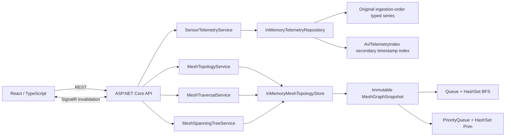
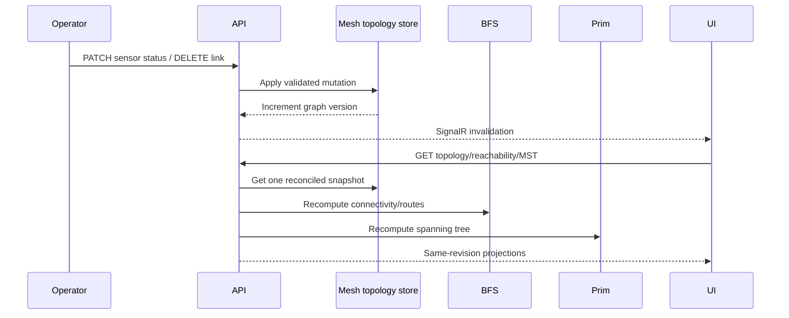

# Smart-X Part 3 — Architecture and Data Structures

**Issue:** P3-12 — final README and technical documentation  
**Source baseline:** post-P3-11 `dev` snapshot at `47c2b1e6105830ceb8673c2c03bffc34f382b194`  
**Purpose:** explain the actual Part 3 implementation, why each structure exists, how it scales, and how its behaviour is verified.

This document focuses on the implementation that directly supports the Part 3 tree/graph rubric. Earlier Part 1/2 structures remain active and are summarised near the end.

---

## 1. System architecture



The design deliberately keeps **authoritative state** and **derived algorithm projections** separate:

- the sensor repository owns registered sensor identity/status;
- the existing telemetry repository owns accepted telemetry and preserves Part 1 ingestion-order behaviour;
- the AVL tree is a secondary timestamp index over the same accepted typed packets;
- the mesh topology store owns explicitly configured simulated links and reconciles those links with current sensor status;
- BFS and Prim read one immutable graph snapshot per calculation and do not create connectivity;
- the frontend consumes versioned HTTP projections and uses SignalR only to know when to refresh.

This avoids a common integration failure: different pages maintaining competing copies of device state, history or graph connectivity.

---

# 2. AVL telemetry history

## 2.1 Why an AVL tree is used

The historical query problem is ordered by **capture timestamp**. A simple append-only `List<T>` is excellent for Part 1 recent ingestion-order history, but a narrow time-range lookup over a large list would normally require scanning unrelated readings. A plain binary search tree can degrade toward a linked list under already sorted or reverse-sorted timestamps.

`AvlTelemetryIndex<T>` therefore maintains a self-balancing binary search tree for each sensor/type. Its key is the UTC timestamp. Equal timestamps do not replace each other; they share one node and retain packets in stable append order.

**Source:** `src/SmartX.Domain/Telemetry/AvlTelemetryIndex.cs`

### Core guarantees

- generic native values (`double`, `int`, `bool`) remain strongly typed;
- all timestamp comparisons use UTC instants;
- duplicate timestamps are preserved in a per-node packet bucket;
- LL, RR, LR and RL imbalance cases are corrected immediately after insertion;
- range queries prune subtrees that cannot intersect the requested interval;
- query results are bounded and copied into read-only snapshots;
- one request is capped by `MaxRangeLimit = 10_000`;
- a composite timestamp + sequence continuation prevents duplicate rows being lost at page boundaries.

## 2.2 Exact balancing excerpt

The following is from the actual insertion implementation:

```csharp
private Node InsertNode(Node? node, DateTimeOffset timestampUtc, TelemetryPacket<T> packet)
{
    if (node is null)
    {
        _distinctTimestampCount++;
        return new Node(timestampUtc, packet);
    }

    int comparison = timestampUtc.CompareTo(node.TimestampUtc);
    if (comparison < 0)
    {
        node.Left = InsertNode(node.Left, timestampUtc, packet);
    }
    else if (comparison > 0)
    {
        node.Right = InsertNode(node.Right, timestampUtc, packet);
    }
    else
    {
        node.Packets.Add(packet);
        return node;
    }

    UpdateHeight(node);
    int balance = BalanceFactor(node);

    if (balance > 1 && timestampUtc < node.Left!.TimestampUtc)
    {
        return RotateRight(node); // LL
    }

    if (balance < -1 && timestampUtc > node.Right!.TimestampUtc)
    {
        return RotateLeft(node); // RR
    }

    if (balance > 1 && timestampUtc > node.Left!.TimestampUtc)
    {
        node.Left = RotateLeft(node.Left);
        return RotateRight(node); // LR
    }

    if (balance < -1 && timestampUtc < node.Right!.TimestampUtc)
    {
        node.Right = RotateRight(node.Right);
        return RotateLeft(node); // RL
    }

    return node;
}
```

The rotations update the demoted node before the new root:

```csharp
private static Node RotateLeft(Node root)
{
    Node newRoot = root.Right!;
    root.Right = newRoot.Left;
    newRoot.Left = root;

    UpdateHeight(root);
    UpdateHeight(newRoot);
    return newRoot;
}

private static Node RotateRight(Node root)
{
    Node newRoot = root.Left!;
    root.Left = newRoot.Right;
    newRoot.Right = root;

    UpdateHeight(root);
    UpdateHeight(newRoot);
    return newRoot;
}
```

### Complexity

Let `n` be the number of **distinct timestamp keys** in one sensor/type index.

- AVL height is `O(log n)`.
- insertion is `O(log n)` worst-case because rebalancing is performed on the insertion path;
- an equal timestamp is found in `O(log n)` and appended to that node's packet bucket;
- storage is `O(n + p)` where `p` is the total number of indexed packets, including duplicates.

The class protects mutations and reads with a short private lock. Smart-X is process-local, so this is an intentionally simple synchronization boundary rather than a distributed index.

## 2.3 Pruned range traversal

The tree does not recursively visit every node. It traverses left only when smaller keys may still be inside the interval, and right only when larger keys may still be inside the interval:

```csharp
private static void CollectRange(
    Node? node,
    DateTimeOffset fromUtc,
    DateTimeOffset toUtc,
    int limit,
    List<TelemetryPacket<T>> destination)
{
    if (node is null || destination.Count >= limit)
    {
        return;
    }

    if (node.TimestampUtc > fromUtc)
    {
        CollectRange(node.Left, fromUtc, toUtc, limit, destination);
    }

    if (destination.Count >= limit)
    {
        return;
    }

    if (node.TimestampUtc >= fromUtc && node.TimestampUtc <= toUtc)
    {
        foreach (TelemetryPacket<T> packet in node.Packets)
        {
            if (destination.Count >= limit)
            {
                break;
            }

            destination.Add(packet);
        }
    }

    if (node.TimestampUtc < toUtc && destination.Count < limit)
    {
        CollectRange(node.Right, fromUtc, toUtc, limit, destination);
    }
}
```

For a balanced index, the implementation documents the bounded range operation as **`O(log n + k)`**, where `k` is the number of packets copied into the result.

## 2.4 Why duplicate timestamps need a bucket

IoT data can legitimately contain multiple readings at the same timestamp, particularly imported historical batches or devices with coarse clocks. Replacing a key would lose data. Creating multiple tree nodes with the same key complicates BST ordering and cursor correctness.

Smart-X instead has one AVL node per distinct timestamp and a stable packet list inside that node. P3-11 verifies duplicate windows across pages using a timestamp + sequence cursor.

## 2.5 AVL limits and evidence

The committed real-API fixtures are:

- `docs/evidence/part3/telemetry-10k.json`
- `docs/evidence/part3/telemetry-50k.json`

They prove:

- descending arrival rather than only friendly sorted data;
- 10,002 and 50,002 indexed Float packets respectively;
- additional typed Integer and Boolean series;
- duplicate timestamp retention across two result pages;
- exact keyset traversal;
- invalid range requests rejected;
- the original Part 1 recent ingestion-order semantics preserved;
- accepted/processed worker deltas matched.

The timing samples are **client-observed HTTP end-to-end measurements**. They include JSON/server/network overhead and are not isolated AVL microbenchmarks or hard CI latency thresholds. Structural invariants are verified by Domain tests instead.

---

# 3. Mesh graph representation

## 3.1 Why a graph is the correct model

A mesh network is not hierarchical: a sensor can have several peers, cycles are valid, and a relay may disappear while alternative paths remain. A tree alone cannot represent all possible configured links.

Smart-X therefore models:

- the logical gateway and registered sensors as **vertices** (`MeshNode` / `MeshNodeKey`);
- explicit configured radio-like relationships as undirected **edges** (`MeshLink`);
- each edge with one positive finite `SimulatedEnergyCost`;
- one immutable `MeshGraphSnapshot` per graph revision.

**Store:** `src/SmartX.Infrastructure/Topology/InMemoryMeshTopologyStore.cs`

The topology store is synchronised and versioned. Sensor status is reconciled into graph vertices. Offline, Fault, Maintenance and Decommissioned sensors remain visible in the inventory but are not forwarding-eligible.

The system does **not** infer missing physical links from proximity, status or UI layout.

## 3.2 Simulated cost boundary

`SimulatedEnergyCost` is a relative weight chosen for deterministic routing demonstrations. It is not a measured property of Wi-Fi, Zigbee, Thread, LoRa or any real radio.

This distinction matters when interpreting Prim: Smart-X proves the algorithm on a weighted graph; it does not claim that the numeric weight is a calibrated physical-energy measurement.

---

# 4. BFS gateway reachability and fewest-hop routing

## 4.1 Objective

BFS answers:

> Which forwarding-eligible sensors are reachable from the gateway, and what route uses the fewest configured links?

It deliberately ignores `SimulatedEnergyCost`. In an unweighted graph, first discovery by BFS yields a minimum-hop path.

**Source:** `src/SmartX.Application/Topology/MeshTraversalService.cs`

## 4.2 Actual Queue/visited implementation

```csharp
var pending = new Queue<MeshNodeKey>();
var visited = new HashSet<MeshNodeKey> { MeshNodeKey.Gateway };
var hopCounts = new Dictionary<MeshNodeKey, int>
{
    [MeshNodeKey.Gateway] = 0
};
var predecessors = new Dictionary<MeshNodeKey, MeshNodeKey>();

pending.Enqueue(MeshNodeKey.Gateway);

while (pending.Count > 0)
{
    cancellationToken.ThrowIfCancellationRequested();
    MeshNodeKey current = pending.Dequeue();
    int nextHop = checked(hopCounts[current] + 1);

    foreach (MeshNodeKey next in neighbours[current])
    {
        if (!visited.Add(next))
        {
            continue;
        }

        hopCounts.Add(next, nextHop);
        predecessors.Add(next, current);
        pending.Enqueue(next);
    }
}
```

### Why these structures were chosen

- `Queue<T>` preserves level order: every `d`-hop vertex is expanded before a newly discovered `d+1`-hop vertex.
- `HashSet<T>` makes cycle/duplicate discovery checks average `O(1)` and ensures a vertex is expanded once.
- `Dictionary<T,T>` predecessor mapping reconstructs a route only when needed, rather than copying a full path for every vertex during traversal.

### Complexity

Adjacency construction plus BFS is **`O(V + E)` time** and **`O(V + E)` space**. Path reconstruction for a selected device is `O(h)` in its number of hops.

Smart-X also performs a linear scan over the eligible adjacency to label gateway-disconnected connected components. It uses the same graph revision, preventing a route result and component result from describing different sensor states.

---

# 5. Prim minimum spanning tree

## 5.1 Objective

Prim answers:

> Which set of links connects the gateway-reachable component while minimizing the **sum of selected simulated link costs**?

This is not the same objective as BFS. An MST is a **global spanning structure**, not a collection of independently cheapest source-to-gateway paths.

**Source:** `src/SmartX.Application/Topology/MeshSpanningTreeService.cs`

## 5.2 Actual min-heap implementation

```csharp
var visited = new HashSet<MeshNodeKey> { MeshNodeKey.Gateway };
var selected = new List<MeshTreeBranch>();
var frontier = new PriorityQueue<FrontierEdge, FrontierPriority>();

void EnqueueOutgoing(MeshNodeKey parent)
{
    foreach (MeshLink link in adjacency[parent])
    {
        cancellationToken.ThrowIfCancellationRequested();
        MeshNodeKey child = link.OtherEndpoint(parent);
        if (visited.Contains(child))
        {
            continue;
        }

        frontier.Enqueue(
            new FrontierEdge(parent, child, link),
            new FrontierPriority(
                link.SimulatedEnergyCost,
                link.NodeA,
                link.NodeB,
                link.Id));
    }
}

EnqueueOutgoing(MeshNodeKey.Gateway);

while (frontier.TryDequeue(out FrontierEdge candidate, out _))
{
    cancellationToken.ThrowIfCancellationRequested();

    if (!visited.Add(candidate.Child))
    {
        continue;
    }

    selected.Add(new MeshTreeBranch(
        candidate.Parent, candidate.Child, candidate.Link));
    EnqueueOutgoing(candidate.Child);
}
```

### Why `PriorityQueue` + `HashSet`

- `.NET PriorityQueue<TElement,TPriority>` supplies the minimum-cost frontier edge without sorting the whole edge set on every iteration.
- `HashSet<MeshNodeKey>` ensures each child joins the tree once and prevents cycles.
- deterministic priority tie fields (`NodeA`, `NodeB`, link ID after cost) keep equal-cost behaviour reproducible.

### Complexity

The source documents this edge-frontier Prim implementation as:

- adjacency construction: **`O(V + E)`**;
- heap work: **`O(E log E)`** because each eligible edge is enqueued at most once in the frontier form;
- memory: **`O(V + E)`**;
- the higher-level combined spanning-tree routing projection also performs deterministic result ordering and one `O(V + E)` BFS classification pass.

## 5.3 Independent optimality evidence

P3-11 does not validate Prim by asking Prim whether Prim is correct. The 256- and 1,000-sensor evidence scripts independently recompute the spanning cost using **Kruskal's algorithm** and compare the selected edge count/total cost to the production endpoint.

Examples from committed evidence:

- 256 sensors, after island bridge: production Prim = **260**, independent Kruskal = **260**;
- 1,000 sensors, after island bridge: production Prim = **1004**, independent Kruskal = **1004**;
- after the primary gateway link is removed, all nodes remain reachable through the configured backup and the new totals become **267** and **1011** respectively.

When all gateway links are removed, Smart-X reports every sensor disconnected and a zero-edge gateway tree. It does not create a synthetic recovery link.

---

# 6. BFS vs Prim — same graph, different answers

| Question           | BFS                                                                  | Prim MST                                                        |
| ------------------ | -------------------------------------------------------------------- | --------------------------------------------------------------- |
| Uses edge weights? | No                                                                   | Yes                                                             |
| Main objective     | Fewest configured hops from gateway                                  | Minimum total selected link cost across the reachable component |
| Core frontier      | FIFO `Queue<T>`                                                      | Min-heap `PriorityQueue<TElement,TPriority>`                    |
| Cycle protection   | `HashSet<T>`                                                         | `HashSet<T>`                                                    |
| Result             | Reachability, hop counts, predecessor paths, disconnected components | Tree edges, total simulated cost and tree-derived routes        |
| Time               | `O(V + E)`                                                           | `O(E log E)` heap work plus result ordering/classification      |

A direct one-hop link can be BFS-optimal even when the global MST deliberately connects that sensor through another node because the resulting _whole tree_ has a lower total cost. The UI therefore labels BFS and MST overlays separately instead of implying they are interchangeable.

---

# 7. Self-healing and graph revisions

The term **self-healing** in Smart-X means recomputation from **already configured surviving links** after an authoritative change. It does not mean inventing connectivity.



The P3-11 mesh fixtures exercise:

1. a genuine disconnected island;
2. a bridge link that reconnects it;
3. removal of the preferred gateway edge while a backup remains;
4. removal of every gateway edge, producing explicit disconnection;
5. restoration of the primary gateway edge;
6. invalid writes that must leave graph version and link count unchanged.

---

# 8. API projection consistency

Relevant read routes:

- `GET /api/topology`
- `GET /api/topology/reachability`
- `GET /api/topology/mst`
- `GET /api/topology/devices/{id}/route`
- `GET /api/topology/insights`

Relevant simulation routes:

- `POST /api/topology/links`
- `PATCH /api/topology/links/{id}/cost`
- `DELETE /api/topology/links/{id}`

Simulation writes are allowed in Development/Test and require explicit Production opt-in. The controller/service layer validates node keys, identifiers and positive finite costs before a store mutation.

The frontend never treats SVG layout coordinates as graph truth. The graph, route and MST overlays are derived from the API response.

---

# 9. Earlier required data structures still active

Part 3 integrates rather than discards the earlier coursework structures.

| Structure                                              | Actual purpose                                                                           | Representative source                                                                              |
| ------------------------------------------------------ | ---------------------------------------------------------------------------------------- | -------------------------------------------------------------------------------------------------- |
| `TelemetryPacket<T>`                                   | Strongly typed Float/Integer/Boolean ingestion without one object-typed payload contract | `src/SmartX.Domain/Telemetry/TelemetryPacket.cs`                                                   |
| jagged arrays + `List<T>`                              | Historical batch transport/conversion                                                    | `src/SmartX.Contracts/Telemetry/IngestTelemetryBatchRequest.cs`, telemetry domain/application code |
| recursion                                              | Nested deployment-tree validation                                                        | `src/SmartX.Domain/Deployment/DeploymentTreeValidator.cs`                                          |
| `Queue<T>`                                             | Ordinary FIFO telemetry processing                                                       | `src/SmartX.Infrastructure/Realtime/InMemoryTelemetryWorkBuffer.cs`                                |
| `PriorityQueue<TElement,TPriority>`                    | Critical processing lane and Part 3 Prim frontier                                        | realtime work buffer / `MeshSpanningTreeService.cs`                                                |
| `Stack<CommandRecord>`                                 | Per-device Undo                                                                          | `src/SmartX.Infrastructure/Commands/InMemoryActuatorCommandStore.cs`                               |
| `Dictionary<TKey,TValue>`                              | Canonical device lookup and recommendation pattern statistics                            | sensor repository / pattern store                                                                  |
| `SortedDictionary<DateTimeOffset, List<HistoryEntry>>` | Chronological operational history retaining equal-time events                            | `src/SmartX.Infrastructure/Realtime/InMemoryRealtimeHistoryStore.cs`                               |
| `HashSet<T>`                                           | Unique active-condition membership and graph visited sets                                | dashboard collection / traversal services                                                          |
| AVL tree                                               | Pruned timestamp history queries                                                         | `src/SmartX.Domain/Telemetry/AvlTelemetryIndex.cs`                                                 |
| adjacency-list graph                                   | Explicit mesh connectivity                                                               | `src/SmartX.Infrastructure/Topology/InMemoryMeshTopologyStore.cs`                                  |

The AVL index and Part 2 `SortedDictionary` are **not duplicates**. The first indexes accepted telemetry by capture timestamp for pruned range queries; the second records mixed operational events in chronological buckets.

---

# 10. Verification strategy

Smart-X separates correctness evidence from presentation evidence:

- **Domain tests:** AVL rotations, balance/height invariants, duplicate timestamps, range bounds.
- **Application tests:** BFS paths/components, Prim calculations, topology insight rules.
- **Infrastructure tests:** real repository/store reconciliation, concurrency, live rerouting scenarios.
- **API integration tests:** HTTP validation, graph versions, range queries, link/status mutations and compatibility.
- **Playwright:** all three pillars, selection/draft retention, topology visualization, mutation overlays, AVL history, proactive insights, accessibility and failure recovery.
- **P3-11 scripts:** large real-API telemetry and graph fixtures plus final cross-stack/Docker gate.

The final P3-11 release gate recorded:

- **1,106 backend tests passed, 0 failed**;
- **99 Playwright tests passed, 1 intentionally skipped, 0 failed**;
- audited restore, formatting, lint, production builds and dependency audit passed at the configured thresholds;
- Docker images built and containers became healthy;
- `/ingestion`, `/realtime`, `/topology`, topology API reads and `/hubs/realtime` negotiation succeeded through Nginx.

See [`../evidence/part3/README.md`](../evidence/part3/README.md) for the exact committed artifacts and reproduction commands.

---

# 11. Limits and honest claims

- All graph link costs are simulation values.
- Operational state is process-local; this is not a distributed production topology database.
- Multi-page AVL reads are live keyset reads, not one transactionally isolated database snapshot.
- Client-observed timing evidence includes HTTP/serialization overhead.
- AVL/graph asymptotic complexity follows the implementation and algorithm structure; timing fixtures are supporting observations, not complexity proofs.
- Prim minimizes the total selected tree cost; Smart-X does not label it as shortest-path routing.
- BFS produces fewest-hop paths only among forwarding-eligible configured vertices/links.
- Offline/fault/maintenance/decommissioned sensors can remain visible but cannot silently relay traffic.
- Production topology mutation is opt-in because the current simulation endpoint is not an authenticated physical-network management plane.

These boundaries are intentional: they keep the PoE technically accurate while making the required algorithms directly inspectable and reproducible.
